# Documento de Investigación y Fundamentación UX/UI — EcoImperio

> **Asignatura**: Interfaz de Usuario — Examen Final Integrador (EFI)  
> **Proyecto**: EcoImperio — Red de Reciclaje Barrial y Gamificación Ciudadana (Río Cuarto, Córdoba)  
> **Versión del Prototipo**: v1.2 / v2.0 (Mobile-First Web SPA & Figma)

---

## 1. Resumen de la Idea

**EcoImperio** es una aplicación web progresiva (Mobile-First SPA) diseñada para incentivar, organizar y gamificar el reciclaje domiciliario en los barrios de la ciudad de **Río Cuarto**.

El problema central que aborda es la desconexión entre la intención del vecino de separar sus residuos reciclables (plástico PET, cartón, papel, vidrio y aluminio) y la incertidumbre cotidiana sobre:
1. **Dónde está la Campana Verde o Punto Limpio más cercano** a su domicilio.
2. **En qué estado de capacidad se encuentra el contenedor** en tiempo real (evitando que el vecino camine con bolsas de reciclables hasta una campana que ya está desbordada o llena).
3. **Qué beneficio tangible recibe** por sostener el hábito en el tiempo.

A través de un mapa barrial interactivo con estados de ocupación en tiempo real (`Vacío / Disponible` vs. `Lleno`), un escáner de códigos QR/materiales en el punto de depósito y una billetera digital de **EcoPuntos**, cada vecino suma puntos verificados que puede canjear por descuentos reales en **Comercios Adheridos de cercanía** (panaderías, librerías, cafeterías y almacenes de su propio barrio).

---

## 2. Datos de la Empresa / Organización

- **Nombre de la marca / producto**: **EcoImperio** (en articulación con la iniciativa de gestión ambiental de la *Municipalidad de Río Cuarto*, conocida históricamente como la *"Capital Alterna"* o *"El Imperio del Sur"*).
- **Eslogan**: *"Reciclá, sumá puntos, transformá tu ciudad — Unite a la comunidad verde de Río Cuarto"*.
- **Identidad Visual e Iconografía de Tienda (App Icon & Variantes de Logo)**:
  1. **App Icon / Store Badge (Formato Circular / Squircle 1:1)**: Contenedor `Squircle` con gradiente verde bosque profundo (`#065f46` → `#1b4332`), coronado en el borde superior por la **corona dorada (`#f59e0b`)** que alude al apodo histórico de Río Cuarto (*"El Imperio del Sur"*), y en el centro el **brote orgánico de dos hojas (`#34d399` / `#6ee7b7`)** que simboliza regeneración ambiental. Diseñado para lectura instantánea en grillas de tiendas (`Google Play` / `App Store` / `PWA Home Screen`).
  2. **Logotipo Tipográfico Principal (Horizontal)**: Tipografía geométrica `Inter Black` (`900`) de alto peso visual que combina el prefijo `"Eco"` en esmeralda accesible (`#047857`) y `"Imperio"` en pizarra profundo (`#0f172a`), acompañado del isotipo circular y el descriptor local `"COMUNIDAD VERDE • RÍO CUARTO"`.
  3. **Variante Monocromática / Alto Contraste (WCAG AAA $\ge 7:1$)**: Versión en trazo amarillo puro (`#ffff00`, ratio `19.56:1`) y blanco (`#ffffff`, ratio `21:1`) sobre fondo negro absoluto (`#000000`) para máxima legibilidad en personas con baja visión, cataratas o fotofobia.

### Galería de Variantes Oficiales de Marca

| Variante 1: App Icon / Store Badge (1:1) | Variante 2: Logotipo Horizontal Oficial | Variante 3: Monocromático Alto Contraste (AAA) |
| :---: | :---: | :---: |
|  |  | 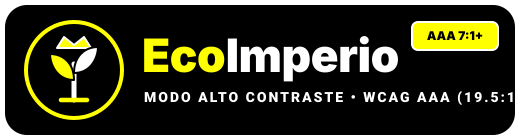 |
| *Ícono de tienda e instalador PWA (`160×160`)* | *Cabeceras, papelería institucional y presentación* | *Modo Alto Contraste WCAG AAA (`19.56:1`)* |

---

## 3. Valor Agregado (Diferenciación frente a Alternativas Abiertas o Gratuitas)

Frente a alternativas genéricas o gratuitas existentes (como mapas estáticos en Google My Maps publicados por municipios, folletos PDF en portales gubernamentales o planillas de horarios de recolección), **EcoImperio** aporta cuatro diferenciales concretos:

| Criterio | Alternativas Abiertas / Gratuitas (Google Maps, PDFs Municipales) | Valor Agregado de **EcoImperio** |
| :--- | :--- | :--- |
| **Estado del contenedor** | Estático: muestra la ubicación geográfica pero no si la campana está rebalsada o fuera de servicio. | **Semáforo de disponibilidad en tiempo real**: diferenciación por color + ícono + etiqueta textual (`Vacío` en verde vs. `Lleno` en rojo) para evitar viajes en vano. |
| **Motivación y retención** | Nula: depende exclusivamente del altruismo individual sin retroalimentación ni seguimiento. | **Economía circular barrial (EcoPuntos)**: gamificación con barra de progreso hacia metas claras y descuentos directos en comercios locales de Río Cuarto. |
| **Validación en sitio** | Inexistente: no registra el hábito ni orienta sobre qué material depositar frente al contenedor. | **Escáner QR y clasificador de materiales**: confirma qué tipo de residuo es reciclable (`PET 1`, `Cartón`, `Vidrio`) y acredita los puntos en el acto. |
| **Inclusión y Accesibilidad** | Mapas densos y PDFs no adaptados a pantallas móviles ni a personas mayores o con baja visión. | **Accesibilidad Universal (WCAG AA / AAA)**: 3 modos visuales (Claro, Oscuro, Alto Contraste), escalado tipográfico hasta `125%`, reducción de movimiento y navegación 100% por teclado/táctil con una sola mano. |

---

## 4. Impacto en la Comunidad Local (Río Cuarto)

1. **Impacto Ambiental Directo**: Reduce el volumen de residuos sólidos urbanos enterrados en el predio sanitario local y disminuye la basura dispersa alrededor de campanas verdes colapsadas (al redirigir a los vecinos hacia puntos con capacidad disponible en barrios como *Alberdi*, *Banda Norte*, *Centro*, *Bimaco*, *Abilene* y *Golf*).
2. **Impacto Económico Barrial**: A diferencia de los programas de fidelización de grandes cadenas comerciales, los **Comercios Adheridos** son emprendimientos locales de Río Cuarto (*Panadería El Imperio*, *Librería La Biblioteca*, *Café de la Plaza*), impulsando el consumo de cercanía.
3. **Inclusión Ciudadana Intergeneracional**: Su diseño contemplando personas mayores o con visión reducida permite que toda la familia participe del hábito sin barreras tecnológicas.

---

## 5. Implementación de los Conceptos Teóricos de la Cátedra

A continuación se detalla cómo se implementó técnicamente cada uno de los **10 bloques conceptuales** de la asignatura dentro de **EcoImperio**:

### 5.1. Concepto 01 — Experiencia de Usuario (UX vs. UI y los 5 Pilares)
- **Fundamento teórico**: Basado en Yusef Hassan Montero, el diseño no es decoración superficial (UI) sino resolución de problemas reales (UX) sostenida en 5 pilares: **Usabilidad, Accesibilidad, Utilidad, Desempeño y Emoción/Estética**.
- **Implementación en EcoImperio**:
  - **Desempeño percibido y cero parpadeo (FOUC)**: Un script crítico en el `<head>` lee las preferencias de tema y tamaño tipográfico desde `localStorage` antes del primer pintado de pantalla. Además, las acciones transaccionales muestran feedback inmediato mediante un componente Toast no bloqueante (`role="status" aria-live="polite"`).
  - **Prevención de errores sin culpar al usuario**: En Login, Registro y Configuración se eliminó el `alert()` nativo y se implementaron mensajes contextuales debajo de cada campo con instrucciones constructivas (ej. *"Ingresá los 10 dígitos sin 0 ni 15. Ej: 3584123456"*).
  - **Separación de acciones destructivas**: En `Configuración`, la acción *"Eliminar cuenta"* está aislada en una "Zona de peligro" al final de la vista y protegida por un modal `<dialog>` nativo donde el foco inicial recae en *"Cancelar"*.
- **Evidencia visual (Captura)**:

  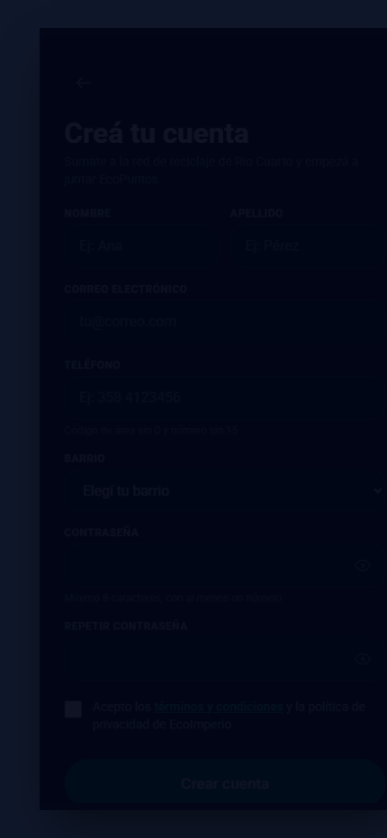

### 5.2. Concepto 02 — Usabilidad y Accesibilidad (Principios POUR y WCAG 2.0/2.2)
- **Fundamento teórico**: La usabilidad es relativa al perfil del usuario, mientras que la accesibilidad es universal (Perceptible, Operable, Comprensible y Robusto — POUR).
- **Implementación en EcoImperio**:
  - **Prueba de la Mano Atada (100% Operable por Teclado)**: Todos los flujos (`Splash → Login → Mapa → Escáner → Mis EcoPuntos → Configuración`) son recorribles con `Tab`, `Shift+Tab`, `Enter`, `Espacio` y `Escape` (para cerrar el menú lateral o modales). El menú lateral (`#drawer-menu`) utiliza el atributo `inert` cuando está cerrado para evitar trampas de foco fuera de pantalla.
  - **Contraste Verificado (WCAG AA $\ge 4.5:1$ y WCAG AAA $\ge 7:1$)**: En Modo Claro y Oscuro se supera el ratio 4.5:1 (usando `#047857` para botones primarios con texto blanco a `5.48:1` y `slate-600`/`slate-300` para textos secundarios), mientras que el **Modo Alto Contraste** emplea fondo negro `#000000`, bordes blancos `#ffffff` y acentos amarillos `#ffff00` (`> 15:1`).
  - **Codificación Redundante**: En el mapa, el estado de las campanas nunca depende solo del color: combina **Color** (verde/rojo) + **Ícono distinto** (`location` vs `ban`) + **Etiqueta explícita entre paréntesis** (`Alberdi (Vacío)` vs `B° Norte (Lleno)`).
- **Evidencia visual (Captura)**:

  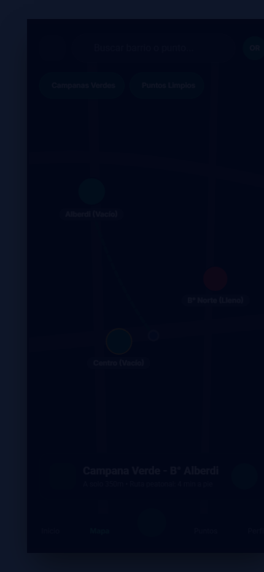
  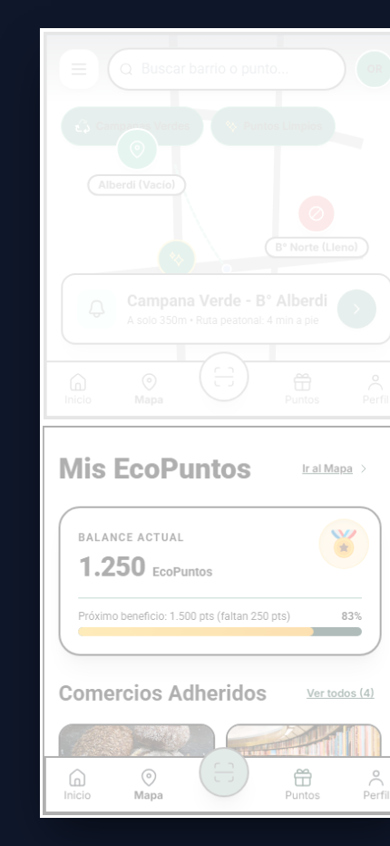

### 5.3. Concepto 03 — Modelos Mentales, Affordance y Mapeo Natural
- **Fundamento teórico**: El usuario llega con modelos mentales previos (Leyes de Jakob) y necesita pistas visuales claras de cómo se opera cada objeto (**Affordance** de Norman) y correspondencia espacial (**Mapeo Natural**).
- **Implementación en EcoImperio**:
  - **Affordance táctil**: Los botones parecen botones reales gracias a su volumen, bordes redondeados, sombras y efecto de hundimiento físico al presionarlos (`transform: scale(0.98)` / `active:scale-95`). Jamás se usan textos ambiguos como *"Click aquí"*.
  - **Íconos acompañados de texto**: Tanto en la barra de navegación inferior (`Inicio`, `Mapa`, `Escáner`, `Puntos`, `Perfil`) como en el menú lateral y filtros del mapa, cada ícono va acompañado de su rótulo textual para evitar ambigüedad.
  - **Mapeo Natural**: Los toggles de Modo Oscuro, Alto Contraste, Tamaño de texto y Reducción de animaciones aplican el cambio en vivo en el mismo instante en que el usuario los acciona, sin obligarlo a presionar un botón de guardado.
- **Evidencia visual (Captura)**:

  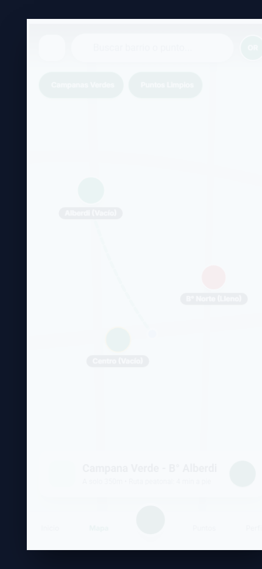

### 5.4. Concepto 04 — Psicología de la Gestalt y Jerarquía Visual
- **Fundamento teórico**: El cerebro agrupa estímulos visuales según las leyes de **Proximidad, Semejanza, Región Común, Continuidad y Cierre**, y escanea la pantalla siguiendo patrones **Z** y **F**.
- **Implementación en EcoImperio**:
  - **Ley de Proximidad**: En los formularios de Login, Registro y Perfil, cada `<label>` está a `4px` (`mb-1`) de su `<input>` correspondiente, mientras que los grupos de campos distintos están separados por `12px–16px` (`space-y-3` / `space-y-4`).
  - **Ley de Región Común**: La Card de Balance, las Cards de Comercios Adheridos, las Cards de Historial y las 4 secciones de Configuración están delimitadas por contenedores `<article>` y `<section>` con bordes, fondo diferenciado y `border-radius: 16px` (`rounded-2xl`).
  - **Patrón en Z (Splash y Mapa)**: El ojo inicia arriba a la izquierda (selector de tema / menú hamburguesa), cruza arriba a la derecha (badge de versión / avatar de perfil `OR`), baja en diagonal por el centro (identidad visual con silueta de Río Cuarto / marcadores del mapa) y remata abajo en el llamado a la acción principal (`"Comenzar"` / card flotante y botón central de Escáner).
  - **Prueba del Entrecerrar los Ojos (Squint Test)**: Al aplicar desenfoque sobre `Mis EcoPuntos`, el saldo `1.250 EcoPuntos` y el botón central destacan inmediatamente como primer nivel jerárquico.
- **Evidencia visual (Captura)**:

  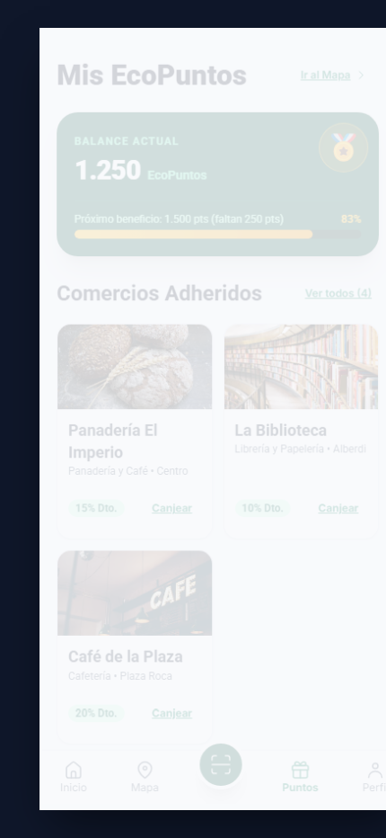

### 5.5. Concepto 05 — Estética Funcional: Color, Tipografía y los 5 Estados UI
- **Fundamento teórico**: El color comunica estados semánticos (límite de ~5 colores activos), la tipografía establece una escala modular legible y todo elemento interactivo debe responder a **5 estados obligatorios**.
- **Implementación en EcoImperio**:
  - **Paleta Semántica y Matriz de Contraste Verificado (WCAG AA / AAA)**:

    | Rol Semántico | Token / Color de Texto | Color de Fondo | Ratio Calculado | Nivel WCAG | Aplicación en EcoImperio |
    | :--- | :--- | :--- | :---: | :---: | :--- |
    | **Primario (Botón CTA)** | `#ffffff` (Blanco) | `#047857` (`emerald-700`) | **5.48 : 1** | **AA** | Botones `.btn-primary` (`Comenzar`, `Registrar Depósito`, `Canjear`) |
    | **Texto Principal (Claro)** | `#0f172a` (`slate-900`) | `#f8fafc` (`slate-50`) | **17.40 : 1** | **AAA** | Títulos `h1`–`h4`, saldos y etiquetas de formulario |
    | **Texto Secundario (Claro)** | `#475569` (`slate-600`) | `#ffffff` (`white`) | **7.58 : 1** | **AAA** | Subtítulos, horarios, distancias y ayudas contextuales |
    | **Texto Principal (Oscuro)** | `#f8fafc` (`slate-50`) | `#0f172a` (`slate-900`) | **17.40 : 1** | **AAA** | Cuerpo principal y tarjetas en Modo Oscuro (`html.dark`) |
    | **Peligro / Contenedor Lleno** | `#ffffff` (Blanco) | `#dc2626` (`red-600`) | **4.83 : 1** | **AA** | Marcadores `B° Norte (Lleno)` y botón `Eliminar cuenta` |
    | **Alto Contraste Oscuro** | `#ffff00` (Amarillo puro) | `#000000` (Negro puro) | **19.56 : 1** | **AAA** | Botones activos, enlaces y píldoras `aria-pressed="true"` en HC |
    | **Alto Contraste Claro** | `#000000` (Negro puro) | `#ffffff` (Blanco puro) | **21.00 : 1** | **AAA** | Superficies, textos, bordes de `3px` y estados activos invertidos |

  - **Escala Tipográfica Modular**: Fuentes `Roboto` (cuerpo y lectura) e `Inter` (botones y navegación), con escala `h1: 32px (2rem)`, `h2: 24px (1.5rem)`, `h3: 18px (1.125rem)`, `h4: 16px (1rem)`, `body & inputs: 16px (1rem)` y `captions/badges: 12px–14px`.
  - **Matriz de los 5 Estados UI en todos los controles**:

    | Estado UI | Regla CSS / Tailwind Implementada | Comportamiento Visual y Sensorial |
    | :--- | :--- | :--- |
    | **1. Default** | `.btn-primary`, bordes `border-slate-200`, sombra suave | Apariencia tridimensional clara que invita a la acción (*Affordance*). |
    | **2. Hover** | `hover:bg-emerald-800`, `transform: translateY(-1px)` | Elevación sutil de `1px` y oscurecimiento cromático al pasar el puntero. |
    | **3. Active** | `active:scale-95`, `transform: scale(0.98)` | Hundimiento físico inmediato al presionar con el pulgar o clic. |
    | **4. Focus** | `:focus-visible { outline: 3px solid #34d399; box-shadow: var(--focus-ring); }` | Anillo de foco de alto contraste para navegación 100% por teclado (`Tab`). |
    | **5. Disabled** | `:disabled { opacity: 0.55; cursor: not-allowed; transform: none; }` | Bloqueo visual y funcional durante envíos asíncronos para evitar doble clic. |

- **Evidencia visual (Captura)**:

  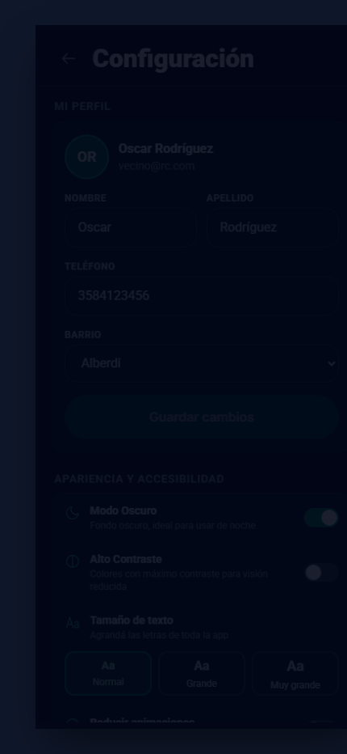

### 5.6. Concepto 06 — Diseño Centrado en el Usuario (DCU), Personas y Journey Map
- **Fundamento teórico**: Diseñar para arquetipos realistas documentando sus metas, frustraciones y el mapa de experiencia (User Journey Map) en contexto real de uso.
- **Implementación en EcoImperio**:
  - **Fichas de User Personas (Regla de los 5 Puntos)**:

    | Atributo DCU | Persona 1: **Oscar Rodríguez / Tomás** (Vecino Activo) | Persona 2: **Marta Quiroga** (Vecina con Baja Visión) |
    | :--- | :--- | :--- |
    | **1. Perfil y Contexto** | 34 años, empleado administrativo en B° Alberdi (Río Cuarto). Camina 6 cuadras hacia el centro cargando la bolsa de reciclables en una mano y el celular en la otra. | 64 años, docente jubilada en B° Centro. Utiliza anteojos multifocales y sufre encandilamiento bajo luz solar directa en la vereda. |
    | **2. Metas** | Saber rápido qué campana tiene lugar disponible de camino al trabajo y acumular puntos para canjear descuentos en comercios de su barrio. | Consultar el cronograma de recolección de su barrio, identificar qué material acepta cada contenedor y usar sus EcoPuntos sin depender de terceros. |
    | **3. Frustraciones (Pain Points)** | Caminar hasta una campana verde y encontrarla desbordada; interfaces con botones diminutos imposibles de tocar con una sola mano; perder el saldo al cerrar el navegador. | Textos grises pequeños (`< 14px`), mapas que solo usan colores sin texto para indicar estados, y animaciones bruscas que le generan mareo visual. |
    | **4. Habilidades Digitales** | Media-Alta (uso diario de WhatsApp, billeteras virtuales y mapas en Android). | Básica-Media (prefiere flujos lineales, botones grandes con texto explícito y confirmaciones claras). |
    | **5. Solución en EcoImperio** | Barra inferior fija al alcance del pulgar (`56px`), filtro `"Campanas Verdes"` con etiqueta `(Vacío)` / `(Lleno)` y persistencia en `localStorage`. | Escala tipográfica hasta `125%` (`Extra grande`), Modo Alto Contraste WCAG AAA (`21:1`), switch `"Reducir animaciones"` y validación constructiva. |

  - **Matriz Completa del User Journey Map (Recorrido de Punta a Punta)**:

    | Etapa | 1. Descubrimiento | 2. Búsqueda Barrial | 3. Traslado y Verificación | 4. Depósito y Escaneo QR | 5. Recompensa y Canje |
    | :--- | :--- | :--- | :--- | :--- | :--- |
    | **Acción del Vecino** | Abre **EcoImperio** e inicia sesión con su cuenta o acceso rápido demo. | Busca su barrio en el Mapa y filtra por `"Campanas Verdes"`. | Camina hacia la campana sugerida verificando la ruta peatonal. | Selecciona el material (`PET 1`, `Cartón`, `Vidrio`) y escanea el código QR del punto. | Suma `+10 EcoPuntos`, revisa su progreso y canjea un cupón en un comercio local. |
    | **Pantalla / Canal** | `#screen-splash` → `#screen-login` | `#screen-mapa` (Buscador + Píldoras `aria-pressed`) | `#screen-mapa` (Card flotante con ruta y distancia) | `#screen-escaner` (Selector de material + visor QR) | `#screen-puntos` + `<dialog id="redeem-dialog">` |
    | **Pensamiento** | *"Quiero entrar rápido sin llenar formularios eternos en la vereda."* | *"¿La campana de B° Norte tendrá lugar o estará rebalsada?"* | *"Veo que B° Norte está llena; mejor voy a Plaza Roca o Alberdi que figuran vacías."* | *"Tengo envases de vidrio, ¿este contenedor los recibe?"* | *"¡Genial! Ya llegué a 200 puntos para el 15% OFF en Almacén Natural."* |
    | **Curva Emocional** | 😐 Neutral / Expectante | 🤔 Crítico / Atento | 😌 Aliviado (evitó un viaje en vano) | 😊 Confiado y guiado | 🤩 Entusiasmado / Recompensado |
    | **Oportunidad Técnica Implementada** | Botón de autocompletado de cuenta demo + validación `onBlur` sin `alert()`. | Codificación redundante: Color + Ícono + Texto `(Vacío)` / `(Lleno)`. | Redirección automática al punto disponible más cercano con cálculo de cuadras. | Ruteo inteligente: al elegir `Vidrio (GL 70)`, el sistema asigna `Punto Limpio - Plaza Roca`. | Modal de confirmación de canje con descuento real de saldo y cupón `ECO-XXXX` en Historial. |

  - **Evidencia de Iteración del Ciclo DCU**:
    - *Hallazgo en prueba de usabilidad*: En la primera versión del prototipo, los botones de `"Canjear"` en Comercios Adheridos solo mostraban un aviso informativo sin descontar puntos ni validar el saldo, y el selector de `Vidrio (GL 70)` en el escáner acreditaba el depósito en una Campana Verde que solo admite Plástico y Cartón.
    - *Rediseño iterado en código*: Se incorporó el costo explícito en cada comercio (`150` a `250 EcoPuntos`), un diálogo `<dialog>` de confirmación con validación de saldo en tiempo real, el registro del cupón canjeado en el Historial y el ruteo automático de `Vidrio` hacia el `Punto Limpio - Plaza Roca`.
- **Evidencia visual (Captura)**:

  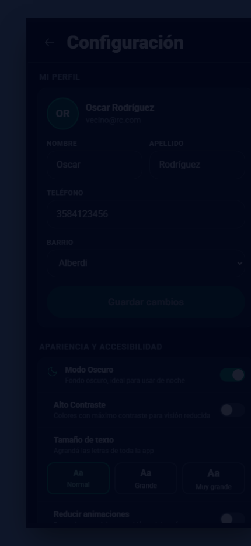

### 5.7. Concepto 07 — Arquitectura de la Información (AI) y Rotulado
- **Fundamento teórico**: Los 4 pilares de Morville y Rosenfeld: **Organización, Etiquetado (Labeling) libre de jerga técnica, Navegación con profundidad máxima de 2–3 clics y Búsqueda/Filtrado**.
- **Implementación en EcoImperio**:
  - **Diagrama Sitemap / Árbol de Contenidos (Profundidad Plana $\le 2$ clics)**:

    ```mermaid
    flowchart TD
      Splash["1. Portada (Splash Screen)"] --> Login["2. Iniciar Sesión"]
      Splash --> Registro["3. Crear Cuenta"]
      Login --> Mapa["4. Mapa de Puntos Verdes (Hub Principal)"]
      Registro --> Mapa
      Mapa <--> Escaner["5. Escáner QR y Clasificador de Materiales"]
      Mapa <--> Puntos["6. Mis EcoPuntos (Balance, Comercios e Historial)"]
      Mapa <--> Config["7. Configuración (Perfil, Accesibilidad y Seguridad)"]
      Mapa -.-> GuiaDialog["Modal: Guía de Separación y Cronograma Barrial"]
      Puntos -.-> RedeemDialog["Modal: Confirmación de Canje en Comercio"]
      Config -.-> DeleteDialog["Modal: Zona de Peligro (Eliminar Cuenta)"]
    ```

  - **Matriz de Card Sorting (Consolidación de Categorías Mentales)**:

    | Categoría Consolidada (Destino UI) | Tarjetas / Acciones Evaluadas por los Usuarios | Ubicación en la Interfaz |
    | :--- | :--- | :--- |
    | **Mapa Barrial (`Mapa`)** | *Buscar campana por barrio*, *Ver si el contenedor está lleno o vacío*, *Filtrar Puntos Limpios vs. Campanas*, *Consultar horarios y guía de separación*. | Tab `Mapa` (Barra inferior) + Buscador y píldoras superiores |
    | **Registrar Reciclaje (`Escáner`)** | *Escanear código QR del contenedor*, *Elegir tipo de residuo (Plástico, Cartón, Vidrio)*, *Acreditar depósito en el punto*. | Botón central destacado `Escáner` en Barra Inferior |
    | **Billetera y Beneficios (`Puntos`)** | *Ver mi saldo de EcoPuntos*, *Ver cuánto falta para el próximo beneficio*, *Canjear descuento en panadería/almacén*, *Revisar historial de reciclaje*. | Tab `Puntos` (Barra inferior) + Ítem `Mis EcoPuntos` en Drawer |
    | **Ajustes y Cuenta (`Perfil / Configuración`)** | *Cambiar teléfono o nombre*, *Activar Modo Oscuro o Alto Contraste*, *Agrandar letra*, *Restablecer demo*, *Cerrar sesión o eliminar cuenta*. | Tab `Perfil` (Barra inferior) + Ítem `Configuración` en Drawer |

  - **Tabla Comparativa de Rotulado (Labeling — Modelo del Desarrollador vs. Modelo del Vecino)**:

    | Etiqueta Técnica Descartada (Jerga de BD / Dev) | Etiqueta Implementada en **EcoImperio** | Justificación de Usabilidad y Modelo Mental |
    | :--- | :--- | :--- |
    | ❌ `Geolocalización de Nodos RSU` | ✅ **Mapa de Puntos Verdes** | El vecino de Río Cuarto busca *"Puntos Verdes"* o *"Campanas"*, no siglas técnicas de residuos sólidos. |
    | ❌ `Capacidad < 80%` / `Overflow_True` | ✅ **`(Vacío)` / `(Lleno)`** | Lenguaje directo y binario que responde en 1 segundo si conviene caminar hasta ese contenedor. |
    | ❌ `Ejecutar Transacción Token QR` | ✅ **Registrar Depósito (+10 EcoPuntos)** | Comunica exactamente la acción física que realiza el vecino y el beneficio inmediato que obtiene. |
    | ❌ `Parámetros de Renderizado DOM / A11y` | ✅ **Accesibilidad y Pantalla** | Agrupa de forma comprensible el Modo Oscuro, Alto Contraste, Tamaño de texto y Reducción de animaciones. |
    | ❌ `Confirmar: Sí / No` (en baja de cuenta) | ✅ **`Cancelar` / `Sí, eliminar`** | Verbos de acción específicos que previenen errores catastróficos por lectura rápida. |

- **Evidencia visual (Captura)**:

  

### 5.8. Concepto 08 — Wireframing y Buenas Prácticas en Figma (Auto-Layout y Restricciones)
- **Fundamento teórico**: Evolución desde el wireframe de baja fidelidad (Lo-Fi) en escala de grises hacia el prototipo de alta fidelidad (Hi-Fi) aplicando Auto-Layout, Constraints y cero pantallas callejón sin salida (*dead-ends*).
- **Implementación en EcoImperio**:
  - **Tabla Comparativa de Evolución: Wireframe Lo-Fi vs. Prototipo Hi-Fi / SPA**:

    | Dimensión de Diseño | Etapa 1: Wireframe Lo-Fi (Baja Fidelidad en Figma) | Etapa 2: Prototipo Hi-Fi y SPA Final (`index.html` + `style.css`) |
    | :--- | :--- | :--- |
    | **Paleta y Superficies** | Escala de grises neutra (`#E5E7EB`, `#9CA3AF`, `#1F2937`) para validar jerarquía sin sesgo cromático. | Sistema tricolor accesible:Modo Claro (`Slate-50`/`Emerald-700`), Modo Oscuro (`Slate-950`) y Modo Alto Contraste (`#000000`/`#ffff00`). |
    | **Contenido y Copy** | Etiquetas estructurales preliminares y marcadores de posición para tarjetas de comercios e historial. | Datos reales de **Río Cuarto** (*B° Alberdi*, *Banda Norte*, *Plaza Roca*, *Panadería El Imperio*) y microcopy validado. |
    | **Auto-Layout y Resizing** | Frames verticales con `Gap: 12px/16px`, `Padding: 16px/24px` y tarjetas con `Fill container`. | Flexbox y CSS Grid (`flex-col`, `space-y-4`, `grid-cols-2`, `w-[80%] mx-auto`) con adaptación fluida al escalar texto al `125%`. |
    | **Restricciones (Constraints)** | `Top & Left/Right` para el Header y `Bottom` fijo para la Barra de Navegación Inferior. | Contenedor `.mobile-viewport` con `<header>` fijo arriba, `<main class="flex-1 overflow-y-auto">` central y `<nav>` fijo abajo. |
    | **Prevención de Dead-Ends** | Conexiones básicas entre pantallas principales. | Cero callejones sin salida: todas las vistas poseen botón `"← Volver"`, Barra Inferior de 5 destinos y Menú Lateral (`Drawer`). |

- **Evidencia visual (Captura)**:

  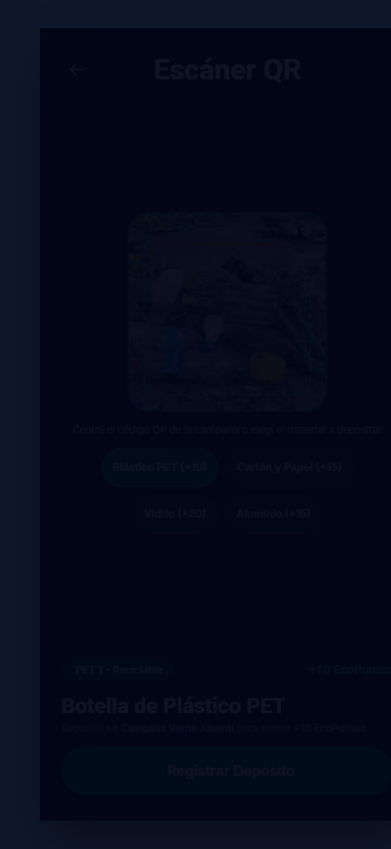

### 5.9. Concepto 09 — Sistema de Diseño, Diseño Atómico y Microinteracciones
- **Fundamento teórico**: Construcción modular mediante **Átomos, Moléculas y Organismos** gobernados por Design Tokens (variables CSS) y microinteracciones con propósito.
- **Implementación en EcoImperio**:
  - **Design Tokens en `:root` (`style.css`)**: Variables centralizadas para colores semánticos (`--color-primary`, `--color-secondary`, `--focus-ring`), radios y sombras.
  - **Diseño Atómico**:
    - *Átomos*: Botones (`.btn-primary`, `.btn-secondary`), badges de descuento, íconos con `aria-hidden="true"`, inputs con tamaño base `16px`.
    - *Moléculas*: Campo de formulario con label + input + mensaje de error accesible; fila de switch de configuración; card de historial de reciclaje (al `80%` de ancho con `<h3>`, `<p>` y `<h4>`).
    - *Organismos*: Card de Balance con barra de progreso dinámica, grilla de Comercios Adheridos (50% imagen / 50% información), Barra de Navegación Inferior y Menú Lateral (`Drawer`).
  - **Matriz de Microinteracciones (Disparador → Regla → Respuesta Visual y Accesibilidad)**:

    | Microinteracción | Disparador (Trigger) | Regla / Lógica de Negocio | Respuesta Visual y Auditiva (Feedback) | Adaptación en `reduce-motion` |
    | :--- | :--- | :--- | :--- | :--- |
    | **1. Láser del Escáner QR** | Ingresar a `#screen-escaner` o seleccionar un material reciclable. | Guía el encuadre del código QR de la campana y adapta el contenedor destino según el residuo (`Vidrio` → `Punto Limpio`). | Línea esmeralda luminosa con `@keyframes scan` vertical (`2.5s infinite ease-in-out`) y actualización del badge de puntos. | Se detiene la animación continua (`animation: none !important`) dejando la guía estática. |
    | **2. Píldoras de Filtro y Material** | Clic / Tap o tecla `Enter`/`Espacio` sobre `.map-filter-pill` o `.scanner-material-btn`. | Conmuta el atributo `aria-pressed="true/false"` y filtra en vivo los marcadores del mapa o el residuo activo. | Cambio instantáneo de relleno, borde e ícono, más notificación en región `aria-live="polite"`. | Transición instantánea (`0ms`) sin desplazamiento espacial. |
    | **3. Acreditación y Canje de EcoPuntos** | Confirmar depósito en Escáner (`+10/12/15 pts`) o confirmar canje en Comercio (`-150 a -250 pts`). | Actualiza `state.ecoPoints`, recalcula el porcentaje hacia la meta (`1.500 pts`), persiste en `localStorage` e inserta ítem en `#history-list`. | La barra `#points-progress-bar` anima su ancho (`transition-all duration-500`), el botón muestra spinner temporal y emerge un Toast accesible. | El ancho de la barra y el Toast cambian sin interpolación de movimiento. |
    | **4. Validación `onBlur` en Formularios** | Perder el foco (`blur`) o modificar (`change`) un campo inválido en Login, Registro o Perfil. | Evalúa formato de correo, teléfono de 10 dígitos (`358...`) o longitud de contraseña (`>= 8`). | Borde rojo (`border-red-500`), activación de `aria-invalid="true"` y aparición del texto constructivo debajo del campo. | Aparición inmediata sin sacudidas bruscas (*shake*). |

- **Evidencia visual (Captura)**:

  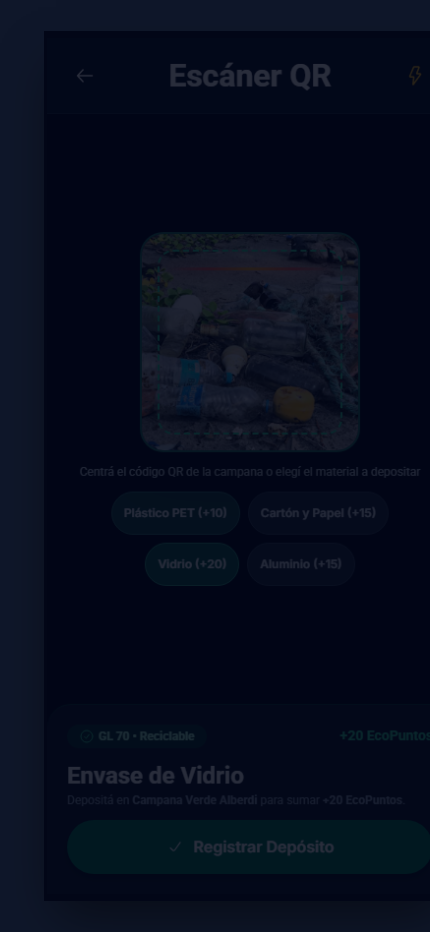

### 5.10. Concepto 10 — Accesibilidad Aplicada, UX Writing y Patrones Avanzados
- **Fundamento teórico**: Contraste real verificado, áreas táctiles $\ge 44\times44\text{px}$, formularios con `aria-invalid`/`aria-describedby`, enlaces diferenciados por subrayado, verbos específicos en diálogos y **Empty States** accionables.
- **Implementación en EcoImperio**:
  - **Áreas táctiles $\ge 44\times44\text{px}$**: Todos los botones de navegación, botones de volver, toggles de mostrar/ocultar contraseña, filtros del mapa y cierre de menú cumplen el área mínima de `44×44px`.
  - **Inputs móviles a `16px` (`1rem`)**: Evita el zoom forzado en navegadores móviles y garantiza lectura cómoda.
  - **Matriz de Auditoría de UX Writing y Accesibilidad WCAG (5 Columnas Obligatorias)**:

    | Elemento Original / Problema Detectado | Copy Mejorado (UX Writing en **EcoImperio**) | Patrón de Interacción Implementado | Criterio WCAG 2.1 / 2.2 Cumplido | Sugerencia UI / Visual Implementada |
    | :--- | :--- | :--- | :--- | :--- |
    | **1. Error genérico en Teléfono** (*"Input inválido"*) | *"Ingresá los 10 dígitos sin el 0 ni el 15 (ej: 3584123456)."* | Validación en tiempo real (`onBlur` y `onInput`) vinculada con `aria-describedby="reg-phone-error"`. | **WCAG 3.3.1** (Identificación de errores) y **3.3.3** (Sugerencia ante errores - Nivel AA). | Texto en rojo accesible (`#dc2626` / `#f87171` en oscuro) ubicado a `4px` debajo del input con borde resaltado. |
    | **2. Marcadores de mapa solo por color** (Verde vs. Rojo) | **`Alberdi (Vacío)`** vs. **`B° Norte (Lleno)`** + aviso *"Contenedor al límite de capacidad. Te sugerimos ir a..."* | Codificación redundante triple: Color semántico + Ícono diferenciado (`location` vs. `ban`) + Etiqueta textual. | **WCAG 1.4.1** (Uso del color - Nivel A) y **1.4.3 / 1.4.6** (Contraste AA/AAA). | Píldora de alto contraste debajo de cada pin del mapa y bloqueo preventivo del botón de ruta en puntos llenos. |
    | **3. Historial vacío en cuentas nuevas** (*Lista en blanco sin explicación*) | *"Todavía no registraste depósitos. ¡Acercate a una Campana Verde y escaneá tu primer QR para sumar EcoPuntos!"* + CTA **`Ir al Escáner QR`**. | **Empty State accionable** que educa al vecino recién registrado y le ofrece el siguiente paso lógico. | **WCAG 2.4.6** (Encabezados y etiquetas descriptivas) y **3.2.4** (Identificación coherente). | Contenedor con borde punteado, ícono ilustrativo de reciclaje y botón secundario de `>= 44px` de alto. |
    | **4. Confirmación ambigua en acción destructiva** (*"¿Está seguro? Sí / No"*) | Título: *"¿Eliminar cuenta permanentemente?"* — Botones: **`Cancelar`** (foco inicial) y **`Sí, eliminar`**. | Modal nativo `<dialog>` con bloqueo de fondo (`backdrop`) y retorno de foco al cerrar con `Escape`. | **WCAG 3.3.4** (Prevención de errores en acciones críticas) y **2.1.1 / 2.1.2** (Teclado sin trampas). | Separación previa en card `"Zona de peligro"` con borde rojo y foco seguro por defecto en la opción no destructiva. |
    | **5. Botones de Canje sin confirmación de costo** (*"Canjear"*) | Botón **`Canjear (150 pts)`** → Modal: *"¿Confirmás el canje de 15% OFF en Almacén Natural por 150 EcoPuntos?"* → **`Confirmar canje`**. | Verificación previa de saldo (`state.ecoPoints >= cost`), confirmación explícita y generación de cupón único `ECO-XXXX`. | **WCAG 3.3.4** (Prevención de errores en transacciones) y **4.1.3** (Mensajes de estado vía `role="status"`). | Badge de costo visible en cada tarjeta de comercio y registro inmediato del descuento en el Historial con signo negativo (`-150 pts`). |

- **Evidencia visual (Captura)**:

  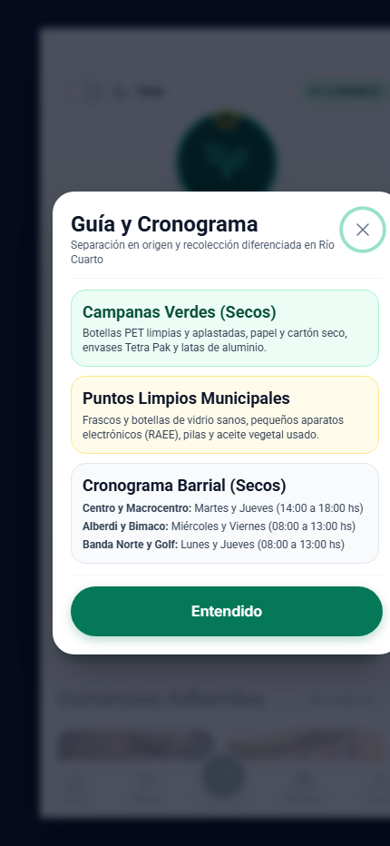

---

## 6. Equipo de Trabajo

El proyecto **EcoImperio** fue investigado, diseñado y desarrollado por el equipo de estudiantes de la carrera de **Desarrollo de Software — ITEC Río Cuarto**:

| Foto / Avatar | Nombre y Apellido | Rol en el Proyecto | Breve Biografía / Enfoque Técnico |
| :---: | :--- | :--- | :--- |
|  | **Manuel Gómez** | Product Lead, Frontend Architecture & UX Interaction | Estudiante de Desarrollo de Software en ITEC Río Cuarto (`manuel.gomez@itecriocuarto.org.ar`). Responsable de la lógica interactiva de la SPA (`app.js`), persistencia de estado, motor de canje de EcoPuntos, validaciones de formularios y coordinación técnica del repositorio. |
|  | **Tomás Benavidez** | UX/UI Design Lead & Accessibility Specialist | Estudiante de Desarrollo de Software en ITEC Río Cuarto (`t.benavidez@itecriocuarto.org.ar`). Enfocado en el Sistema de Diseño Atómico, prototipado en Figma (Lo-Fi a Hi-Fi), cumplimiento de contrastes WCAG AA/AAA y arquitectura de la información. |
|  | **Valentino Cambria** | UI Components, Mobile-First Layout & QA | Estudiante de Desarrollo de Software en ITEC Río Cuarto (`v.cambria@itecriocuarto.org.ar`). Especializado en maquetación semántica HTML5, estilizado adaptable con Tailwind CSS, verificación de los 5 estados interactivos y pruebas de usabilidad móvil. |
|  | **Juan Falco** | UX Research, Relevamiento Territorial & Testing | Estudiante de Desarrollo de Software en ITEC Río Cuarto. Responsable del relevamiento de Puntos Verdes y comercios barriales de Río Cuarto, definición de User Personas, pruebas de recorrido por teclado y validación heurística. |

---

## 7. Estructura de Entrega (`EFI-Equipo/`)

De acuerdo con la consigna oficial de la cátedra, el paquete final se organiza en:
1. **`Prototipo - Web SPA/`**: Código fuente ejecutable (`index.html`, `style.css`, `app.js`) + enlace al prototipo interactivo en Figma (`Reto 4`).
2. **`Documento con la investigación/`**: El presente documento técnico con capturas de pantalla de cada concepto implementado.
3. **`Presentación/`**: Guion estructurado para la defensa oral (máximo 20 minutos) y soporte visual en Prezi / video demostrativo.
