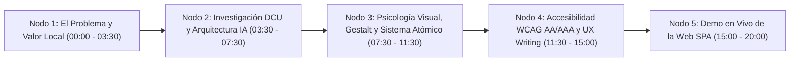

# Guion de Defensa Oral y Estructura de Lienzo Prezi — EcoImperio (EFI 2026)

> **Asignatura**: Interfaz de Usuario — Examen Final Integrador (EFI)  
> **Institución**: ITEC Río Cuarto — Desarrollo de Software  
> **Duración máxima**: 20 minutos (16 min de exposición + 4 min de demostración en vivo y preguntas)  
> **Equipo**: Manuel Gómez, Tomás Benavidez, Valentino Cambria y Juan Falco

---

## 1. Mapa Visual del Lienzo Prezi (Arquitectura de Nodos Zoomables)

Para aprovechar la narrativa espacial de **Prezi**, el lienzo principal representa un **Mapa Verde Ilustrado de la Ciudad de Río Cuarto** con **5 Nodos Temáticos** conectados en sentido horario:

---

## 2. Distribución de Roles y Tiempos por Orador (20 Minutos)

| Bloque | Horario | Orador Sugerido | Ejes Conceptuales Cubiertos |
| :--- | :---: | :--- | :--- |
| **Bloque 1: Problema, Identidad y Valor Local** | `00:00 – 03:30` | **Juan Falco** | Resumen de la idea, Identidad de marca (3 variantes de logo), Valor Agregado frente a Google Maps/PDFs e Impacto en Río Cuarto. |
| **Bloque 2: DCU, Personas y Arquitectura (IA)** | `03:30 – 07:30` | **Tomás Benavidez** | Conceptos 06, 07 y 08: User Personas (*Oscar* y *Marta*), User Journey Map, Card Sorting, Rotulado sin jerga y evolución Lo-Fi a Hi-Fi en Figma. |
| **Bloque 3: Gestalt, Estética y Sistema de Diseño** | `07:30 – 11:30` | **Valentino Cambria** | Conceptos 03, 04, 05 y 09: Affordance, Mapeo Natural, Leyes de Gestalt, Patrón Z, Paleta Semántica, los **5 Estados UI** y Microinteracciones. |
| **Bloque 4: UX, Accesibilidad Universal y UX Writing** | `11:30 – 15:00` | **Manuel Gómez** | Conceptos 01, 02 y 10: Los 5 pilares de UX, Principios POUR, Contraste WCAG AA/AAA, Navegación 100% por teclado y Auditoría UX Writing. |
| **Bloque 5: Demostración Interactiva en Vivo** | `15:00 – 20:00` | **Equipo Completo (Guía: Manuel Gómez)** | Recorrido completo en la Web SPA: Login → Mapa Barrial → Escáner QR → Canje en Comercios → Modo Alto Contraste y Prueba de la Mano Atada. |

---

## 3. Guion Técnico Detallado Paso a Paso

### 🟢 Bloque 1: El Problema, Identidad de Marca y Valor Comunitario (`00:00 – 03:30`)
**Orador**: *Juan Falco*  
**Soporte en Prezi**: *Zoom hacia el Nodo 1 (Centro Cívico y Plaza Roca de Río Cuarto)*.

1. **Gancho inicial (00:00 - 01:00)**:
   - *"¿A cuántos nos pasó salir de casa en Río Cuarto con una bolsa de botellas plásticas o cartón, caminar cuatro cuadras hasta la Campana Verde del barrio y encontrarla completamente desbordada?"*
   - Presentar **EcoImperio**: una Progressive Web SPA Mobile-First que conecta a los vecinos con los puntos de reciclaje de su barrio en tiempo real y transforma el hábito ambiental en **EcoPuntos** canjeables en comercios locales.
2. **Identidad Corporativa (01:00 - 02:00)**:
   - Mostrar las **3 variantes oficiales del logotipo**:
     - **App Icon (Squircle 1:1)**: fusiona la corona dorada (*"El Imperio del Sur"*) con el brote orgánico de dos hojas.
     - **Logotipo Horizontal**: tipografía geométrica `Inter Black` de alta legibilidad.
     - **Variante Monocromática WCAG AAA**: trazo amarillo (`#ffff00`) y blanco sobre fondo negro puro (`#000000`, ratio `19.56:1`).
3. **Valor Agregado e Impacto en Río Cuarto (02:00 - 03:30)**:
   - Comparar con soluciones gratuitas estáticas (Google My Maps o folletos PDF municipales): **EcoImperio** ofrece **estado de ocupación en tiempo real (`Vacío` vs. `Lleno`)**, clasificador de materiales en sitio y una economía circular con comercios de cercanía (*Panadería El Imperio*, *Librería La Biblioteca*, *Café de la Plaza*, *Almacén Natural*).

---

### 🔵 Bloque 2: Diseño Centrado en el Usuario (DCU), Arquitectura e Iteración (`03:30 – 07:30`)
**Orador**: *Tomás Benavidez*  
**Soporte en Prezi**: *Zoom hacia el Nodo 2 (Fichas de User Personas, Matriz Journey Map y Wireframes Figma)*.

1. **User Personas y Contexto de Uso (`Concepto 06`, 03:30 - 05:00)**:
   - Presentar los dos arquetipos diseñados bajo la **Regla de los 5 Puntos**:
     - **Oscar Rodríguez (34 años, B° Alberdi)**: camina al trabajo con una bolsa de reciclables en una mano y el celular en la otra. Necesita operar toda la app con el pulgar (`Bottom Navbar` de `56px`) y saber en 2 segundos qué campana está vacía.
     - **Marta Quiroga (64 años, B° Centro)**: docente jubilada con visión reducida y encandilamiento en exteriores. Necesita textos escalables al `125%`, Modo Alto Contraste AAA y cero animaciones bruscas.
   - Mostrar la **Matriz del User Journey Map** y cómo convertimos el punto crítico de frustración (llegar a una campana llena en *B° Norte*) en una redirección proactiva hacia *Plaza Roca* o *Alberdi*.
2. **Arquitectura de la Información y Rotulado (`Concepto 07`, 05:00 - 06:30)**:
   - Explicar el **Sitemap de profundidad plana ($\le 2$ clics)**: ninguna acción queda oculta.
   - Mostrar la **Tabla de Rotulado (Labeling)**: cómo descartamos jerga técnica de base de datos (`Geolocalización de Nodos RSU`, `Capacidad < 80%`) por el modelo mental del vecino (`Mapa de Puntos Verdes`, `(Vacío)` / `(Lleno)`).
3. **De Lo-Fi a Hi-Fi (`Concepto 08`, 06:30 - 07:30)**:
   - Mostrar la evolución desde el wireframe en escala de grises en Figma (`Auto-Layout`, `Constraints` fijos arriba y abajo) hasta la maquetación final en CSS Flexbox/Grid sin callejones sin salida (*cero dead-ends*).

---

### 🟣 Bloque 3: Psicología de la Gestalt, Estética Funcional y Diseño Atómico (`07:30 – 11:30`)
**Orador**: *Valentino Cambria*  
**Soporte en Prezi**: *Zoom hacia el Nodo 3 (Anatomía de Componentes, Leyes de Gestalt y Los 5 Estados UI)*.

1. **Modelos Mentales, Affordance y Mapeo Natural (`Concepto 03`, 07:30 - 08:45)**:
   - Explicar por qué todos los botones tienen volumen físico, bordes redondeados y hundimiento táctil (`active:scale-95`), y por qué **ningún ícono está huérfano de texto** en la barra inferior ni en los filtros del mapa.
   - Destacar el **Mapeo Natural** en Configuración: los switches de Modo Oscuro, Alto Contraste y Tamaño de Texto aplican los cambios en vivo sin requerir un botón `"Guardar"`.
2. **Leyes de la Gestalt y Jerarquía Visual (`Concepto 04`, 08:45 - 10:00)**:
   - **Proximidad**: cada `<label>` está a `4px` de su `<input>`, mientras que los bloques de campos se separan por `16px`.
   - **Región Común**: tarjetas delimitadas para Balance, Comercios Adheridos e Historial.
   - **Patrón en Z y Squint Test**: al entrecerrar los ojos en `Mis EcoPuntos`, el saldo `1.250 EcoPuntos` y el botón central `Escáner` dominan el primer nivel jerárquico.
3. **Los 5 Estados UI y Microinteracciones (`Conceptos 05 y 09`, 10:00 - 11:30)**:
   - Mostrar la matriz de los **5 estados obligatorios** (`Default`, `Hover`, `Active`, `Focus` con anillo `:focus-visible`, y `Disabled` con bloqueo anti-doble clic).
   - Explicar el **Sistema de Diseño Atómico** (Design Tokens CSS → Átomos → Moléculas → Organismos) y cómo las microinteracciones (láser del escáner QR y barra de progreso) respetan la preferencia `"Reducir animaciones"`.

---

### 🟡 Bloque 4: Los 5 Pilares de UX, Accesibilidad POUR y UX Writing (`11:30 – 15:00`)
**Orador**: *Manuel Gómez*  
**Soporte en Prezi**: *Zoom hacia el Nodo 4 (Matriz de Auditoría WCAG y Arquitectura SPA)*.

1. **UX más allá de la UI (`Concepto 01`, 11:30 - 12:30)**:
   - Explicar cómo **EcoImperio** resuelve los 5 pilares de Hassan Montero: carga instantánea sin parpadeo de tema (`FOUC` prevenido en `<head>`), persistencia real en `LocalStorage` (`ADR-004` y `ADR-005`), y separación de acciones destructivas en una `"Zona de peligro"` con modal `<dialog>` nativo.
2. **Accesibilidad Aplicada y Principios POUR (`Conceptos 02 y 10`, 12:30 - 14:00)**:
   - **Perceptible**: Codificación redundante triple en el mapa (**Color** verde/rojo + **Ícono** `location`/`ban` + **Texto** `(Vacío)`/`(Lleno)`). Ratios de contraste verificados: `5.48:1` en botones primarios (AA) y `19.56:1` a `21:1` en Modo Alto Contraste (AAA).
   - **Operable**: Áreas táctiles mínimas de `44×44px` a `56×56px` (Ley de Fitts) y navegación 100% por teclado con gestión de atributo `inert` en el menú lateral.
3. **Comprensible y UX Writing (14:00 - 15:00)**:
   - Mostrar la **Matriz de Auditoría de 5 Columnas**: validación constructiva en tiempo real (`onBlur`) vinculada por `aria-describedby`, **Empty State accionable** para cuentas nuevas sin historial y verbos específicos en confirmaciones (`"Cancelar"` / `"Sí, eliminar"` y `"Confirmar canje"`).

---

### 🔴 Bloque 5: Demostración Interactiva en Vivo (`15:00 – 20:00`)
**Guía en pantalla**: *Manuel Gómez (con intervenciones del equipo)*

1. **Paso 1 — Splash, Cambio de Tema y Validación Constructiva (`15:00 – 16:00`)**:
   - Iniciar en `#screen-splash`, conmutar el switch `"Tema"` (Claro/Oscuro) en vivo, pasar a `#screen-login`, mostrar la validación `onBlur` al dejar un correo incompleto y usar el botón `"Autocompletar cuenta de prueba (Vecino)"`.
2. **Paso 2 — Mapa Barrial, Codificación Redundante y Filtros (`16:00 – 17:00`)**:
   - Filtrar con las píldoras `"Campanas Verdes"` y `"Puntos Limpios"` (`aria-pressed`), seleccionar el marcador rojo `B° Norte (Lleno)` para mostrar la alerta preventiva que evita el viaje en vano, y luego elegir `Alberdi (Vacío)` o `Plaza Roca (Vacío)`.
3. **Paso 3 — Escáner QR y Coherencia de Materiales (`17:00 – 18:00`)**:
   - Abrir `#screen-escaner`, cambiar el material a **`Vidrio (GL 70)`** para evidenciar cómo la app redirige automáticamente el punto sugerido a `Punto Limpio - Plaza Roca (Centro) • Contenedor de Vidrio` (`+15 EcoPuntos`), y presionar `"Registrar Depósito"`.
4. **Paso 4 — Billetera de EcoPuntos y Canje Real en Comercio (`18:00 – 19:00`)**:
   - En `#screen-puntos`, observar el incremento del saldo (`1.265 EcoPuntos`) y el nuevo registro en el Historial.
   - Presionar **`Canjear`** en *Almacén Natural (15% OFF — 150 EcoPuntos)*, confirmar en el diálogo modal `<dialog>`, mostrar el cupón generado (`ECO-XXXX`), la deducción real del saldo (`1.115 EcoPuntos`) y el ítem `-150 pts` en el Historial.
5. **Paso 5 — Accesibilidad AAA y Prueba de la Mano Atada (`19:00 – 20:00`)**:
   - Ir a `#screen-config`, activar **Modo Alto Contraste** + **Tamaño de texto Extra grande (`125%`)** + **Reducir animaciones**.
   - Navegar usando únicamente la tecla `Tab`, `Enter` y `Escape` para demostrar el anillo `:focus-visible` y los filtros activos de alto contraste, y finalizar presionando `"Restablecer datos de demostración"`.
