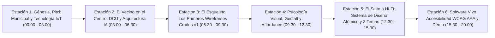

# Presentación Integral Prezi: Guion Técnico, Línea Temporal y Diapositivas — EcoImperio (EFI 2026)

> **Cátedra**: Interfaz de Usuario — Examen Final Integrador (EFI 2026)  
> **Institución**: ITEC Río Cuarto — Tecnicatura Superior en Desarrollo de Software  
> **Duración Máxima**: 20 minutos (16 min de exposición + 4 min de demo en vivo y preguntas)  
> **Equipo**: Manuel Gómez, Tomás Benavidez, Valentino Cambria y Juan Falco  
> **Eje Narrativo Central**: *Línea Temporal de Maduración: Del problema comunitario de Río Cuarto y el primer wireframe en papel, a la implementación de Campanas Inteligentes y Software Vivo con Accesibilidad Universal*.

---

## 1. El Por Qué (Why) de esta Estructura Narrativa

Para que la presentación en **Prezi** sea sobresaliente y cumpla al 100% con los criterios de evaluación de la cátedra:
1. **Línea Temporal Pedagógica**: Se estructura respetando el orden cronológico del cursado (de Clase 1 a Clase 10). Muestra cómo cada concepto teórico aprendido resolvió un problema real detectado en la versión anterior.
2. **Ciclo Completo de Producto (End-to-End)**: No se limita a "mostrar pantallas de un celular". Explica la viabilidad integral: desde el pitch a la Municipalidad de Río Cuarto y la sensorización IoT de las Campanas Verdes, hasta la economía circular con los comercios locales.
3. **Evolución Visual Notoria (Lo-Fi a Hi-Fi)**: Se contrastan los bocetos primitivos con las pantallas finales en vivo en sus 3 modos (Claro, Oscuro y Alto Contraste AAA).

---

## 2. Mapa Espacial del Lienzo Prezi (Línea de Tiempo en 6 Macro-Estaciones)

Prezi permite una narrativa espacial zoomable. El lienzo general es una **Línea de Tiempo Infográfica sobre el Mapa Ilustrado de Río Cuarto (del Puente Colgante a la Plaza Roca)**:

---

## 3. Distribución de Roles, Tiempos y Conceptos por Orador

| Bloque / Estación | Minutos | Orador Sugerido | Conceptos Teóricos Vinculados | Entregables Clave a Mostrar |
| :--- | :---: | :--- | :--- | :--- |
| **Estación 1: Génesis, Pitch e IoT** | `00:00 – 03:00` | **Juan Falco** | Introducción al Dominio, Valor Agregado vs Gratuito, Impacto Comunitario. | Identidad de marca (3 logos), Convenio Municipal, Hardware de Campana Inteligente. |
| **Estación 2: DCU y Arquitectura** | `03:00 – 06:30` | **Tomás Benavidez** | `06_DCU_Personas_y_Journey_Map` `07_Arquitectura_de_Informacion` | User Personas (*Oscar* y *Marta*), Journey Map de frustración a alivio, Card Sorting y Sitemap plano. |
| **Estación 3: Primeros Wireframes v1** | `06:30 – 09:30` | **Valentino Cambria** | `08_wireframe` (Baja fidelidad) `01_UX` (Pilares de Usabilidad) | El boceto primitivo en papel, Wireframes grises con cajas `[X]`, detección de callejones sin salida. |
| **Estación 4: Gestalt, Affordance y Fitts**| `09:30 – 12:30` | **Tomás Benavidez** | `03_Modelos_Mentales_y_Affordance` `04_Gestalt_y_Jerarquia_Visual` `05_estetica_funcional` | Leyes de Proximidad y Región Común, Patrón Z (Squint Test), Ley de Fitts (zonas del pulgar de 56px). |
| **Estación 5: Hi-Fi, Tokens y 3 Temas** | `12:30 – 15:30` | **Manuel Gómez** | `08_++_Buenas_Practicas_Figma` `09_Sistema_De_Disenio` `10_accesibilidad_aplicada` | Tokens CSS esmeralda, Auto-Layout, Matriz de los 5 Estados UI, Modo Oscuro y Alto Contraste AAA (19.56:1). |
| **Estación 6: Demo en Vivo y Cierre** | `15:30 – 20:00` | **Equipo Completo (Lidera Manuel Gómez)** | `02_usabilidad_y_accesibilidad` Software Vivo (Web SPA) | Recorrido interactivo: Onboarding → Muro Comunidad → Mapa → Escáner QR → Billetera/Canje → Test Mano Atada. |

---

## 4. Estructura Diapositiva por Diapositiva (Contenido Copiable para Prezi)

---

### 🟢 ESTACIÓN 1: El Problema Comunitario, Propuesta de Valor y Viabilidad Integral
*(Minuto 00:00 – 03:00 | Orador: Juan Falco)*

#### Diapositiva 1.1 — Portada y Apertura
- **Título**: EcoImperio: Transformando el Hábito del Reciclaje en Río Cuarto
- **Subtítulo**: De un problema ambiental barrial a un ecosistema de software vivo centrado en las personas
- **Integrantes**: Manuel Gómez, Tomás Benavidez, Valentino Cambria y Juan Falco
- **Institución**: ITEC Río Cuarto — Cátedra de Interfaz de Usuario (EFI 2026)
- **Gancho narrativo**: *"¿Cuántas veces salieron de sus casas con una bolsa de botellas plásticas o cartón, caminaron cuatro cuadras bajo el sol hasta la Campana Verde de su barrio en Río Cuarto y la encontraron completamente desbordada?"*

#### Diapositiva 1.2 — Propuesta de Valor: ¿Por qué no alcanza con Google Maps o un PDF?
- **La Solución Existente (Estática y Frustrante)**:
  - Folletos en PDF de la municipalidad que nadie lee en la calle.
  - Mapas de Google desactualizados sin información de ocupación ni horarios.
- **La Propuesta de EcoImperio (Dinámica y Comunitaria)**:
  - **Estado en tiempo real**: Identificación instantánea de `(Vacío)` vs `(Lleno)` antes de salir de casa.
  - **Asistente de Separación**: Reconocimiento de materiales para no contaminar campanas secas con vidrio no autorizado.
  - **Economía Circular**: Los EcoPuntos acumulados se canjean por descuentos reales en comercios de cercanía (*Panadería El Imperio*, *Librería La Biblioteca*, *Almacén Natural*).

#### Diapositiva 1.3 — Plan de Implementación: De la Idea a la Municipalidad
- **Fase 1: Presentación al Gobierno de Río Cuarto (Subsecretaría de Ambiente)**:
  - Integración sin costo de infraestructura para el vecino.
  - Dashboard de telemetría de rutas de recolección para optimizar camiones de EMOS / Cotreco.
- **Fase 2: Tecnología de Campanas Verdes Inteligentes (Sensorización IoT Progresiva)**:
  - *Etapa Inicial (Software-First)*: Códigos QR de alta durabilidad en cada campana barrial con validación por geocerca GPS móvil.
  - *Etapa Sensorizada (Hardware IoT)*: Sensor ultrasónico de bajo consumo (LoRaWAN / NB-IoT) instalado en la boca de la campana que mide volumen volumétrico (vacío, medio, lleno) y actualiza el mapa automáticamente.
- **Identidad Gráfica Oficial**:
  - Presentar las 3 variantes de marca: **App Icon 1:1** (Squircle corona dorada + brote verde), **Logotipo Horizontal** e **Isologo Monocromático de Alto Contraste AAA**.

---

### 🔵 ESTACIÓN 2: Diseño Centrado en el Usuario (DCU) y Arquitectura de Información
*(Minuto 03:00 – 06:30 | Orador: Tomás Benavidez)*

#### Diapositiva 2.1 — Empatía con el Vecino: User Personas (`Concepto 06`)
- **Arquetipo 1: Oscar Rodríguez (34 años, B° Alberdi — Usuario Operativo)**:
  - *Contexto*: Empleado administrativo, camina al trabajo con la bolsa de reciclables en una mano y el celular en la otra.
  - *Necesidad crítica*: Operar la app con una sola mano (zona del pulgar) y saber en menos de 3 segundos si su campana habitual tiene lugar.
- **Arquetipo 2: Marta Quiroga (64 años, B° Centro — Usuario con Necesidades de Accesibilidad)**:
  - *Contexto*: Docente jubilada, visión disminuida por presbicia y encandilamiento en la vía pública.
  - *Necesidad crítica*: Textos grandes, alto contraste sin brillos cegadores y navegación sin trampas visuales ni animaciones bruscas.

#### Diapositiva 2.2 — User Journey Map: Resolviendo el "Punto de Dolor"
- **El Viaje Antes de EcoImperio (Frustración)**:
  - Separar residuos en el hogar $\rightarrow$ Caminar con carga $\rightarrow$ Campana desbordada de basura $\rightarrow$ Frustración y abandono del hábito ambiental.
- **El Viaje con EcoImperio (Alivio y Recompensa)**:
  - Consulta rápida de mapa desde casa $\rightarrow$ Alerta preventiva en campana llena $\rightarrow$ Redirección fluida a punto disponible $\rightarrow$ Depósito y escaneo QR $\rightarrow$ Bonificación de EcoPuntos y canje barrial.

#### Diapositiva 2.3 — Arquitectura de la Información y Rotulado (`Concepto 07`)
- **Card Sorting con Vecinos**:
  - Cómo agrupamos las secciones de la app en base al modelo mental de los vecinos de Río Cuarto.
- **Tabla de Rotulado Semántico (Sin tecnicismos)**:
  - *Término Técnico Descartado*: `"Puntos de recolección georreferenciados RSU"` $\rightarrow$ *Rótulo Ganador*: `"Mapa de Puntos Verdes"`.
  - *Término Técnico Descartado*: `"Capacidad nominal volumétrica"` $\rightarrow$ *Rótulo Ganador*: `"Estado: (Vacío) / (Lleno)"`.
- **Sitemap Plano**:
  - Estructura de máxima profundidad $\le 2$ clics. Ninguna acción cotidiana queda escondida en submenús profundos.

---

### ⚪ ESTACIÓN 3: Los Primeros Wireframes Crudos (v1) y la Detección de Fricciones
*(Minuto 06:30 – 09:30 | Orador: Valentino Cambria)*

#### Diapositiva 3.1 — El Boceto Primitivo: Dibujando la Estructura en Gris (`Concepto 08`)
- **¿Por qué empezamos en baja fidelidad?**:
  - Cajas neutras, cruces de posición `[X]` y tipografías manuscritas sin colores distractores.
  - Objetivo: Validar flujos de navegación y relaciones espaciales antes de escribir una sola línea de código o discutir paletas de color.
- **Mostrar captura del Wireframe v1 primitivo**:
  - La pantalla inicial con una caja vacía y un solo botón `"Ingresar"`.
  - El mapa primitivo con 3 círculos grises ciegos sin rótulos de estado.

#### Diapositiva 3.2 — Evaluación Heurística: Los Errores que Descubrimos en el Boceto
- **Falla 1: Callejón sin Salida (Dead-End en Inicio)**:
  - *Problema*: Exigía login obligatorio. El vecino no podía ver el mapa sin entregar sus datos.
  - *Solución*: Se agregó el bypass `"Explorar mapa sin cuenta"` y los 3 bloques de propuesta de valor.
- **Falla 2: Ambigüedad del Mapa Ciego**:
  - *Problema*: Los círculos grises no decían qué campana estaba llena ni qué materiales admitía.
- **Falla 3: La Trampa del Menú Lateral Flotante (`Drawer`)**:
  - *Problema*: El panel deslizante superpuesto chocaba con el gesto "volver" de los celulares Android/iOS y creaba trampas de foco en teclado.

---

### 🟣 ESTACIÓN 4: Psicología Visual, Leyes de Gestalt y Affordance
*(Minuto 09:30 – 12:30 | Orador: Tomás Benavidez)*

#### Diapositiva 4.1 — Modelos Mentales y Affordance (`Concepto 03`)
- **Affordance Explícito**:
  - Los botones de EcoImperio no son rectángulos planos: tienen relieve visual, bordes redondeados y respuesta física al presionar (`active:scale-95`).
- **Mapeo Natural en Accesibilidad**:
  - Los controles deslizantes de Modo Oscuro, Alto Contraste y Tamaño de Texto aplican el cambio en tiempo real sobre la pantalla sin necesidad de un botón confuso de `"Guardar y salir"`.

#### Diapositiva 4.2 — Leyes de Gestalt Aplicadas (`Concepto 04`)
- **Ley de Proximidad**: Cada etiqueta de campo (`<label>`) está pegada a 4px de su campo de texto (`<input>`), mientras que los grupos de formulario se distancian a 16px.
- **Ley de Región Común**: Tarjetas de comercios delimitadas con bordes nítidos para que el cerebro identifique instantáneamente qué cupón corresponde a qué negocio.
- **Patrón de Escaneo en Z y Squint Test**:
  - Al entrecerrar los ojos frente a *Mis EcoPuntos*, lo primero que resalta con claridad absoluta es el balance grande (`1.250 pts`) y el botón flotante central de escáner.

#### Diapositiva 4.3 — Ergonomía Táctil y Ley de Fitts (`Concepto 05`)
- Áreas de toque mínimas de $44\times 44\text{px}$ a $56\times 56\text{px}$ en botones críticos.
- **Bottom Navigation Bar fija al pulgar**: Las 5 acciones cardinales (`Comunidad`, `Mapa`, `Escáner`, `Puntos`, `Perfil`) están al alcance natural de la mano sin forzar la muñeca.

---

### 🟡 ESTACIÓN 5: El Salto a Alta Fidelidad (v2), Tokens y los 3 Temas Visuales
*(Minuto 12:30 – 15:30 | Orador: Manuel Gómez)*

#### Diapositiva 5.1 — Sistema de Diseño Atómico y Buenas Prácticas Figma (`Conceptos 08++ y 09`)
- **Jerarquía Atómica**:
  - *Tokens*: Colores esmeralda (`#047857`, `#065F46`), neutros pizarra y escala modular tipográfica `Inter`.
  - *Átomos*: Botones pill, inputs accesibles, chips de filtro.
  - *Moléculas*: Tarjetas de comercios adheridos y tarjetas de publicaciones vecinales.
  - *Organismos*: Cabecera persistente, muro de comunidad y barra de navegación inferior.
- **Auto-Layout y Constraints**: Ningún contenedor tiene anchos fijos desbordables; la interfaz se adapta fluidamente desde pantallas de 360px hasta 420px.

#### Diapositiva 5.2 — La Matriz Obligatoria de los 5 Estados UI
- Demostración de los 5 estados de cada componente interactivo:
  1. `Default`: Estado en reposo con contraste WCAG AA validado ($\ge 4.5:1$).
  2. `Hover`: Elevación visual y sutil cambio cromático al pasar el cursor.
  3. `Active`: Hundimiento físico táctil (`scale-98%`).
  4. `Focus`: Anillo exterior `:focus-visible` de 3px verde esmeralda para navegación 100% por teclado.
  5. `Disabled`: Estado inactivo bloqueado contra doble clic involuntario.

#### Diapositiva 5.3 — Los 3 Temas Visuales y Modo Alto Contraste AAA (`Concepto 10`)
- **Modo Claro (Default)**: Limpieza visual y calidez esmeralda para interiores.
- **Modo Oscuro (`html.dark`)**: Fondo `#020617` para ahorro de batería OLED y visualización nocturna en la vía pública.
- **Modo Alto Contraste (`body.high-contrast`)**:
  - Diseñado para usuarios con baja visión, cataratas o bajo sol radiante de Río Cuarto.
  - Fondo negro puro (`#000000`), bordes blancos sólidos y acentos amarillos puros (`#FFFF00`).
  - **Ratio de contraste certificado de 19.56:1**, superando holgadamente la exigencia estricta de WCAG AAA ($\ge 7:1$).
- **Codificación Redundante Triple**: Nunca comunicar información solo con color. En el mapa: **Color** (verde/rojo) + **Ícono** (campana/alerta) + **Texto explícito** (`(Vacío)` / `(Lleno)`).

---

### 🔴 ESTACIÓN 6: Software Vivo, Demostración en Vivo y Conclusión
*(Minuto 15:30 – 20:00 | Guía de Demo: Manuel Gómez con intervenciones del equipo)*

#### Diapositiva 6.1 — De Prototipo a Software Vivo (La Web SPA Modular)
- Explicación de la arquitectura SPA de producción: sin frameworks pesados ni dependencias externas frágiles (HTML semántico + CSS nativo + JavaScript Vanilla).
- Persistencia real en `LocalStorage`: cuentas de vecino, puntos acumulados, cupones canjeados e historial.

#### Diapositiva 6.2 — Demostración Práctica en Vivo (Paso a Paso en Pantalla)
1. **Paso 1: Onboarding y Acceso Rápido Demo**:
   - Iniciar en `#screen-splash`, mostrar el cambio de tema en cabecera y usar el botón `"Acceso Rápido Demo (1 clic)"` con la cuenta de *Oscar Rodríguez*.
2. **Paso 2: Muro Social Comunitario**:
   - Navegar a `#screen-comunidad`, filtrar entre *Depósitos* y *EcoEventos*, y mostrar cómo el hábito individual se vuelve orgullo colectivo.
3. **Paso 3: Consulta de Mapa y Alerta Preventiva**:
   - Entrar a `#screen-mapa`, seleccionar *B° Norte (Lleno)* para evidenciar cómo la app previene el viaje en vano, y cambiar a *B° Alberdi (Vacío)*.
4. **Paso 4: Escáner QR y Coherencia de Materiales**:
   - Abrir `#screen-escaner`, cambiar el selector a *Vidrio (GL 70)* demostrando la reasignación automática a *Punto Limpio Plaza Roca*, y tocar `"Registrar Depósito (+15 EcoPuntos)"`.
5. **Paso 5: Billetera de Puntos y Canje Real**:
   - En `#screen-puntos`, constatar la subida de saldo a 1.265 pts, abrir `#screen-historial` para ver el impacto en $CO_2$, canjear cupón en *Almacén Natural* mediante modal `<dialog>` y verificar el descuento inmediato.
6. **Paso 6: Prueba de la Mano Atada y Teclado 100%**:
   - Activar **Modo Alto Contraste AAA**, apagar el mouse y navegar toda la app con `Tab`, `Enter` y `Escape`.

#### Diapositiva 6.3 — Conclusiones y Preguntas del Tribunal
- **Impacto de EcoImperio**: Una herramienta viable técnica y humanamente para Río Cuarto.
- **Aprendizaje del Equipo**: Diseñar no es decorar; diseñar es resolver problemas humanos con rigor técnico, empatía y accesibilidad universal.
- Agradecimientos y apertura de preguntas del tribunal.
