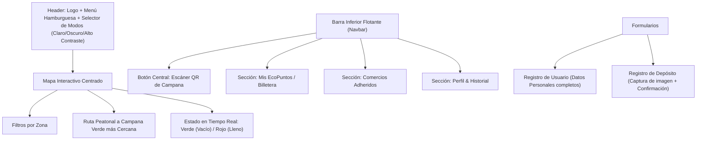

# Arquitectura del Sistema - EcoImperio

## 1. Visión y Propósito
**EcoImperio** es una SPA (Single Page Application) móvil enfocada en la gamificación y motivación del reciclaje barrial. Conecta a vecinos con campanas verdes cercanas a través de un mapa interactivo con estado de contenedores en tiempo real, escáner de códigos QR y una billetera de EcoPuntos canjeables en comercios adheridos del barrio.

## 2. Diagrama de Módulos y Flujo de Navegación (Patrón Z / Mobile-First)

## 3. Componentes y Anatomía Visual

### A. Card de Balance Actual (Mis EcoPuntos)
- Saldo acumulado en EcoPuntos acompañado de una medalla dorada.
- Barra de progreso que indica el porcentaje hacia el próximo beneficio y el objetivo numérico de puntos.

### B. Cards de Comercios Adheridos (50% / 50%)
- Lado izquierdo/superior (50%): Imagen representativa del comercio.
- Lado derecho/inferior (50%): Título en `<h3>`, rubro en `
`, badge de descuento destacado en verde semántico.

### C. Cards de Historial de Reciclaje (Ancho 80%)
- Título en `<h3>`: Material reciclado (ej. Botellas de Vidrio).
- Párrafo en `
`: Ubicación de la campana, fecha y hora.
- Etiqueta `<h4>` alineada a la derecha: Cantidad de EcoPuntos sumados (`+50 pts`).

## 4. Persistencia y Estado Local
- Gestión del estado local de usuario, saldo de EcoPuntos, historial y preferencias de tema mediante `LocalStorage` e `IndexedDB`.
- Cero dependencias de servidor externo (Node.js/Express/Bases de datos SQL/Firebase prohibidos en esta etapa).
