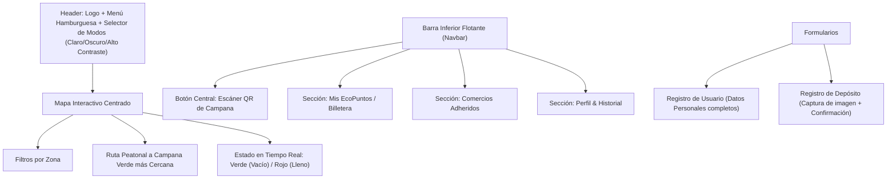

# Arquitectura del Sistema - EcoImperio

## 1. Visión y Propósito
**EcoImperio** es una SPA (Single Page Application) móvil enfocada en la gamificación y motivación del reciclaje barrial. Conecta a vecinos con campanas verdes cercanas a través de un mapa interactivo con estado de contenedores en tiempo real, escáner de códigos QR y una billetera de EcoPuntos canjeables en comercios adheridos del barrio.

## 2. Diagrama de Módulos y Flujo de Navegación (Patrón Z / Mobile-First)

## 3. Componentes y Anatomía Visual

### A. Card de Balance Actual (Mis EcoPuntos)
- Saldo acumulado en EcoPuntos acompañado de una medalla dorada.
- Barra de progreso que indica el porcentaje hacia el próximo beneficio y el objetivo numérico de puntos.

### B. Cards de Comercios Adheridos (50% / 50%)
- Lado izquierdo/superior (50%): Imagen representativa del comercio.
- Lado derecho/inferior (50%): Título en `<h3>`, rubro en `
`, badge de descuento destacado en verde semántico.

### C. Cards de Historial de Reciclaje (Ancho 80%)
- Título en `<h3>`: Material reciclado (ej. Botellas de Vidrio).
- Párrafo en `
`: Ubicación de la campana, fecha y hora.
- Etiqueta `<h4>` alineada a la derecha: Cantidad de EcoPuntos sumados (`+50 pts`).

### D. Registro e Inicio de Sesión (ver ADR-004)
- Flujo: `Splash → Login ⇄ Registro → Mapa`. Las pantallas internas (`mapa`, `escaner`, `puntos`, `config`) requieren sesión; sin sesión, `navigateTo()` redirige al Login.
- Registro: nombre, apellido, email (único), teléfono (10 dígitos), barrio de Río Cuarto, contraseña (mín. 8 caracteres con un número) + confirmación y aceptación de términos. Recién con todos los datos válidos se crea la cuenta y se entra al Mapa.
- Errores por campo debajo del input (`aria-invalid` + `aria-describedby`), con foco en el primer campo inválido.

### E. Configuración (ver ADR-005)
- Pantalla protegida `screen-config`, accesible desde el Drawer. Cuatro secciones:
  1. **Mi perfil**: editar nombre, apellido, teléfono y barrio (mismas validaciones que el Registro). "Guardar cambios" solo se habilita si algo cambió. El email es de solo lectura.
  2. **Apariencia y accesibilidad**: Modo Oscuro, Alto Contraste, Tamaño de texto (Normal 100% / Grande 112.5% / Muy grande 125% del font-size raíz) y Reducir animaciones.
  3. **Notificaciones** (simuladas): campana cercana, campana llena y nuevos beneficios.
  4. **Cuenta y seguridad**: cambiar contraseña (verifica la actual), cerrar sesión y eliminar cuenta con un `<dialog>` de confirmación. La cuenta demo no se puede eliminar.
- Los toggles de tema existen en varias pantallas y se mantienen sincronizados.

## 4. Persistencia y Estado Local
- Gestión del estado local de usuario, saldo de EcoPuntos, historial y preferencias de tema mediante `LocalStorage` e `IndexedDB`.
- Claves de `localStorage`:
  - `ecoimperio_accounts`: cuentas registradas (la contraseña se guarda solo como hash SHA-256).
  - `ecoimperio_dark_mode` / `ecoimperio_high_contrast`: preferencias de tema.
  - `ecoimperio_text_size` (`normal` | `large` | `xlarge`) y `ecoimperio_reduce_motion`: preferencias de accesibilidad (se aplican en el `<head>` antes del primer pintado).
  - `ecoimperio_notifications`: preferencias de avisos (`campanaCercana`, `campanaLlena`, `beneficios`).
- Cero dependencias de servidor externo (Node.js/Express/Bases de datos SQL/Firebase prohibidos en esta etapa).
