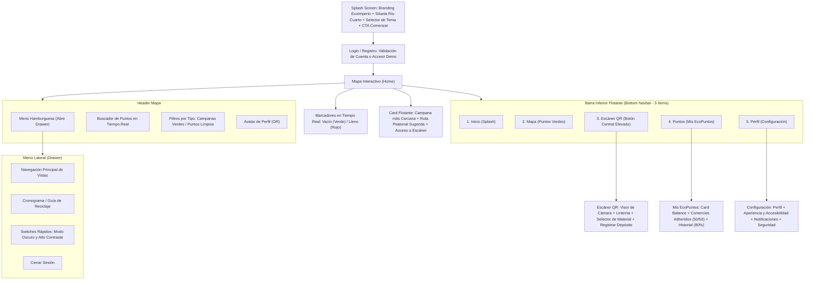

# Arquitectura del Sistema - EcoImperio

## 1. Visión y Propósito
**EcoImperio** es una SPA (Single Page Application) móvil desarrollada en HTML5 semántico, CSS3 (`style.css`), TailwindCSS v3 (CDN) y JavaScript Vanilla ES6+ (`app.js`), enfocada en la gamificación y motivación del reciclaje urbano en la ciudad de Río Cuarto. Conecta a los vecinos con las Campanas Verdes y Puntos Limpios más cercanos mediante un mapa interactivo con estado de capacidad en tiempo real, escáner de códigos QR para validación de depósitos y una billetera de EcoPuntos canjeables en comercios adheridos de la ciudad.

## 2. Diagrama de Módulos y Flujo de Navegación (Patrón Z / Mobile-First)

## 3. Componentes y Anatomía Visual

### A. Card de Balance Actual (Mis EcoPuntos)
- Saldo dinámico acumulado en EcoPuntos acompañado de una medalla dorada (`#f59e0b` / `#fbbf24`).
- Barra de progreso dinámica calculada en tiempo real según el saldo actual del usuario hacia el próximo objetivo de canje (`1.500 pts`), mostrando tanto el porcentaje visual como los puntos restantes o meta alcanzada.

### B. Cards de Comercios Adheridos (50% / 50%)
- Mitad superior/izquierda (50%): Imagen representativa del comercio local con atributo `alt` descriptivo obligatorio.
- Mitad inferior/derecha (50%): Título del comercio en `<h3>`, rubro y dirección en `
`, badge de descuento destacado en verde semántico y botón de acción para canje o detalle de puntos.

### C. Cards de Historial de Reciclaje (Ancho 80%)
- Ancho del 80% del contenedor (`w-4/5` centrado/alineado para diferenciación jerárquica respecto de las tarjetas de ancho completo, evitando desborde horizontal).
- Ícono identificador del material reciclado (`aria-hidden="true"`).
- Título en `<h3>`: Material reciclado (ej. *Plástico PET*, *Vidrio*, *Cartón y Papel*).
- Párrafo en `
`: Ubicación de la campana o punto limpio y marca temporal (fecha y hora).
- Etiqueta `<h4>` alineada a la derecha: Cantidad de EcoPuntos sumados en la operación (`+10 pts`, `+15 pts`, `+45 pts`).

### D. Registro e Inicio de Sesión (ver ADR-004)
- Flujo: `Splash → Login ⇄ Registro → Mapa`. Las pantallas internas (`mapa`, `escaner`, `puntos`, `config`) requieren sesión activa; sin sesión, `navigateTo()` redirige automáticamente al Login.
- Registro: nombre, apellido, email (único), teléfono (10 dígitos), barrio de Río Cuarto, contraseña (mín. 8 caracteres con al menos un número) + confirmación y aceptación de términos. Recién con todos los datos válidos se crea la cuenta y se ingresa al Mapa.
- Errores por campo debajo del input (`aria-invalid="true"` + `aria-describedby`), posicionando el foco en el primer campo inválido.

### E. Configuración y Guía de Reciclaje (ver ADR-005)
- Pantalla protegida `screen-config`, accesible desde la Barra Inferior (`Perfil`) y desde el Drawer (`Configuración`). Cuatro secciones:
  1. **Mi perfil**: editar nombre, apellido, teléfono y barrio (mismas validaciones que el Registro). "Guardar cambios" solo se habilita si hay modificaciones pendientes. El email es de solo lectura.
  2. **Apariencia y accesibilidad**: Modo Oscuro, Alto Contraste, Tamaño de texto (Normal 100% / Grande 112.5% / Muy grande 125% del `font-size` raíz) y Reducir animaciones.
  3. **Notificaciones** (simuladas): campana cercana, campana llena y nuevos beneficios.
  4. **Cuenta y seguridad**: cambiar contraseña (verifica la actual), cerrar sesión y eliminar cuenta mediante un `<dialog>` nativo de confirmación. La cuenta demo no se puede eliminar.
- **Cronograma / Guía de Reciclaje**: Accesible desde el Drawer para consultar qué materiales recibe cada contenedor y los horarios de recolección diferenciada en Río Cuarto.

## 4. Persistencia y Estado Local
- Gestión íntegra del estado local en el navegador mediante `localStorage` (sin `IndexedDB` ni servidores externos, cumpliendo ADR-001 y ADR-004).
- Claves de `localStorage`:
  - `ecoimperio_accounts`: arreglo de cuentas registradas (incluye perfil, hash SHA-256 de contraseña, saldo `ecoPuntos` e `history` de reciclaje por usuario).
  - `ecoimperio_user_data`: persistencia del progreso (`ecoPuntos`, `history` y perfil editado) por email de cuenta, incluyendo la cuenta demo (`vecino@rc.com`).
  - `ecoimperio_dark_mode` y `ecoimperio_high_contrast`: preferencias de tema visual y contraste WCAG AAA.
  - `ecoimperio_text_size` (`normal` | `large` | `xlarge`) y `ecoimperio_reduce_motion`: preferencias de accesibilidad aplicadas en el `<head>` antes del primer pintado.
  - `ecoimperio_notifications`: preferencias de avisos (`campanaCercana`, `campanaLlena`, `beneficios`).
- Cero dependencias de servidor externo (Node.js, Express, bases de datos SQL o Firebase prohibidos en esta etapa).
