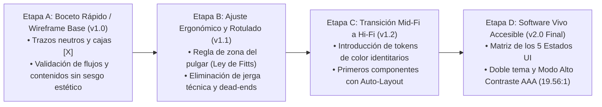

# Bitácora de Mutación y Evolución de Interfaz: De Wireframe a Software Vivo (v1 a v2)

> **Materia**: Interfaz de Usuario — Examen Final Integrador (EFI 2026)  
> **Proyecto**: EcoImperio — Progressive Web SPA Mobile-First (Río Cuarto)  
> **Fundamentación Teórica**: Hassan Montero (Evolución Progresiva, Arquitectura de Información y Evaluación Heurística) & Clase 8/8++ de Cátedra.

---

## 1. El Propósito Metodológico de la Mutación (El *Why*)

En el desarrollo centrado en el usuario (DCU), las pantallas **no surgen mágicamente en su estado final de alta fidelidad**. Mostrar únicamente el producto terminado oculta los aprendizajes y decisiones de diseño.
Registrar las mutaciones permite:
1. **Demostrar Rigor Técnico ante el Tribunal**: Evidenciar cómo cada cambio respondió a una ley de UX (Fitts, Miller, Gestalt), a pruebas de usabilidad o a accesibilidad WCAG.
2. **Preservar el Historial de Decisiones**: Ninguna versión anterior se borra ni reemplaza; coexisten en el lienzo para evidenciar la maduración del software.
3. **Alineación con la Consigna EFI**: La Parte 1 (Investigación) y Parte 2 (Prezi/Defensa oral) exigen contrastar el esqueleto estructural con la solución interactiva final.

---

## 2. Las 4 Etapas del Ciclo de Mutación

Cada ventana de EcoImperio atraviesa 4 estadios evolutivos documentados en Figma y código:



---

## 3. Matriz de Mutación por Ventana (Historial Detallado)

### 3.1. Pantalla de Inicio / Bienvenida (`#screen-splash`)

| Estadio Evolutivo | Estado Visual y Arquitectura | Justificación / Qué Mutó y Por Qué |
| :--- | :--- | :--- |
| **v1.0 — Esqueleto Inicial (Wireframe)** | Caja de imagen cuadrada `[X]`, texto plano `"Bienvenido a EcoImperio"`, un solo botón genérico `"Ingresar"` y sin contexto barrial. | **Problema detectado**: El usuario no entendía qué hacía la app ni de dónde era. Tampoco había salida para explorar sin registrarse (callejón sin salida para usuarios desconfiados). |
| **v1.1 — Incorporación de Propuesta de Valor** | Se divide en 3 bloques apilados: 1. Mapa en vivo, 2. Escáner QR, 3. EcoPuntos locales. Se añaden dos botones: `"Iniciar Sesión"` y `"Crear cuenta"`. | **Mejora de UX**: Reduce la carga cognitiva inicial explicando el modelo mental en 3 pasos antes de exigir credenciales. |
| **v1.2 — Identidad Río Cuarto y Ergonomía (Mid-Fi)** | Se incorpora la silueta urbana de Río Cuarto (catedral y puente), logotipo Squircle (corona + brote verde) y enlace `"Explorar mapa sin cuenta"`. | **Conexión emocional y Ley de Hick**: Permite el ingreso libre de vecinos curiosos reduciendo la fricción a cero clics obligatorios de registro. |
| **v2.0 — Software Vivo Accesible (Final)** | Gradiente esmeralda adaptativo, switch directo de Modo Claro/Oscuro en la cabecera, prevención de parpadeo (`FOUC`), botones de 56px con elevación y foco `:focus-visible`. | **Cumplimiento WCAG**: Contraste 5.48:1 en botón primario y modo oscuro automático para visualización nocturna en la vía pública. |

---

### 3.2. Pantalla de Mapa Barrial (`#screen-mapa`)

| Estadio Evolutivo | Estado Visual y Arquitectura | Justificación / Qué Mutó y Por Qué |
| :--- | :--- | :--- |
| **v1.0 — Mapa Grisáceo Base** | Lienzo neutro con 3 círculos grises idénticos como pines. Buscador simple arriba. | **Falla crítica**: No se distinguía qué material recibía cada punto ni si estaba lleno o vacío. Dependencia absoluta del color. |
| **v1.1 — Píldoras de Filtro y Codificación Dual** | Incorporación de chips: `"Campanas Verdes"` vs `"Puntos Limpios"`. Se agrega tarjeta flotante inferior al tocar un pin. | **Arquitectura de Información**: Separación de contenedores barriales simples vs centros de transferencia con operario municipal. |
| **v1.2 — Codificación Redundante Triple** | Marcadores con **Color** (verde/rojo) + **Ícono** (campana/alerta) + **Texto explícito** (`(Vacío)` / `(Lleno)`). Alerta preventiva en *B° Norte*. | **Accesibilidad Universal (Principio Perceptible)**: Una persona con daltonismo no distingue verde de rojo; el texto y el ícono garantizan comprensión inequívoca. |
| **v2.0 — Navegación Fija y Modo Alto Contraste AAA** | Bottom Navbar persistente anclada al pulgar con botón central de Escáner QR (`56×56px`). Soporte de tema negro puro (`#000000`) con acento amarillo (`#FFFF00`, ratio 19.56:1). | **Ergonomía (Ley de Fitts)** y visualización bajo el sol del mediodía en Río Cuarto sin encandilamiento. |

---

### 3.3. Escáner QR de Depósito (`#screen-escaner`)

| Estadio Evolutivo | Estado Visual y Arquitectura | Justificación / Qué Mutó y Por Qué |
| :--- | :--- | :--- |
| **v1.0 — Visor de Cámara Aislado** | Marco cuadrado central con línea horizontal. Un botón `"Confirmar"`. | **Problema**: Asumía que la cámara siempre reconocería el residuo por visión artificial perfecta, frustrando al usuario si fallaba. |
| **v1.1 — Selector Manual Fallback (2×2)** | Se agregan botones para seleccionar manualmente el residuo: `Plástico PET`, `Papel/Cartón`, `Vidrio`, `Aluminio`. | **Heurística de Tolerancia a Fallos**: Si la cámara no lee el QR desgastado de la campana, el vecino puede registrarlo manualmente. |
| **v1.2 — Coherencia de Destino (Regla de Negocio)** | Al seleccionar `Vidrio`, la app advierte que la Campana Verde común no lo admite y redirige la sugerencia al *Punto Limpio Plaza Roca*. | **Prevención de Errores Ecológicos**: Evita la contaminación de residuos y la rotura de botellas en campanas estándar. |
| **v2.0 — Modo Nocturno y Microinteracciones Accesibles** | Fondo de cámara oscuro `#020617`, botón `"Linterna"`, láser animado con soporte para `prefers-reduced-motion` (se congela si el usuario tiene mareo visual). | **Accesibilidad WCAG 2.2**: Cumple criterio de animación no esencial y facilita el reciclaje nocturno. |

---

### 3.4. Billetera y Recompensas (`#screen-puntos`)

| Estadio Evolutivo | Estado Visual y Arquitectura | Justificación / Qué Mutó y Por Qué |
| :--- | :--- | :--- |
| **v1.0 — Lista Plana de Puntos** | Saldo numérico simple y listado vertical de texto sin jerarquía. | **Falla visual**: El usuario no sentía sensación de progreso ni gamificación (Squint Test reprobado). |
| **v1.1 — Tarjeta Hero y Barra de Meta** | Balance destacado con tamaño 32pt + barra de progreso horizontal (`83% para el próximo beneficio`). | **Psicología Visual (Ley de Región Común)**: Agrupa el estado de cuenta y motiva a completar la meta de reciclaje. |
| **v1.2 — Carrusel de Comercios Barriales y Canje** | Tarjetas de 2 columnas con imagen, logo del comercio de Río Cuarto y botón `"Canjear"`. Modal de confirmación. | **Economía Circular**: Vincula el hábito ambiental con beneficios tangibles en negocios locales (*Panadería El Imperio*, etc.). |
| **v2.0 — Deducción en Tiempo Real y Empty State** | Al canjear, se descuenta el saldo en vivo en `LocalStorage`, genera cupón alfanumérico instantáneo y provee *Empty State* explicativo para usuarios nuevos. | **Visibilidad del Estado del Sistema**: Sin esperas de servidor ni pantallas en blanco desiertas. |

---

## 4. Guía de Organización Espacial en el Lienzo de Figma

Para que el tribunal y el equipo visualicen las mutaciones sin confusión, se estructura cada página de Figma en **calles horizontales de evolución**:

```
[FILA 1: ESTADIO A - WIREFRAME ESTRUCTURAL (v1.0)]
(Grisáceo, fuentes manuscritas, cajas [X], foco en distribución)
┌──────────────┐   ┌──────────────┐   ┌──────────────┐   ┌──────────────┐
│  01. Splash  │ → │  02. Login   │ → │  04. Mapa    │ → │ 05. Escáner  │
└──────────────┘   └──────────────┘   └──────────────┘   └──────────────┘
       ↓                  ↓                  ↓                  ↓ (Anotación: Feedback de usabilidad)
[FILA 2: ESTADIO B - AJUSTES ERGONÓMICOS Y FLUJO (v1.1 / Mid-Fi)]
(Rotulado claro, 3 bloques de valor, fallback manual de cámara, filtros)
┌──────────────┐   ┌──────────────┐   ┌──────────────┐   ┌──────────────┐
│  01. Splash  │ → │  03. Registro│ → │  04. Mapa    │ → │ 05. Escáner  │
└──────────────┘   └──────────────┘   └──────────────┘   └──────────────┘
       ↓                  ↓                  ↓                  ↓ (Anotación: Aplicación de tokens y accesibilidad)
[FILA 3: ESTADIO C - SOFTWARE VIVO / HIGH-FIDELITY (v2.0 Final)]
(Sistema esmeralda, doble tema Claro/Oscuro, Alto Contraste AAA, 5 Estados UI)
┌──────────────┐   ┌──────────────┐   ┌──────────────┐   ┌──────────────┐
│  01. Splash  │ → │  02. Login   │ → │  04. Mapa    │ → │ 05. Escáner  │
└──────────────┘   └──────────────┘   └──────────────┘   └──────────────┘
```

---

## 5. Próximo Paso en Prezi: La Narrativa del "Antes y Después"
En la presentación Prezi, este registro se expondrá en el **Nodo 2 y 3** mediante zoom comparativo:
1. El orador enfoca el **Wireframe v1** y explica qué problema funcional se descubrió.
2. Hace zoom de transición hacia la **v2 final** mostrando la solución aplicada en código.
