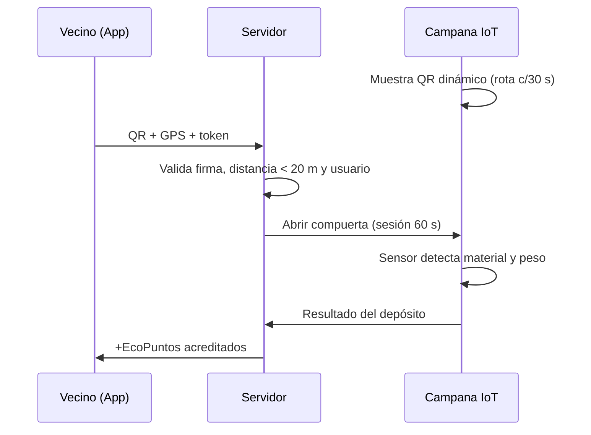

# Registro de Decisiones de Arquitectura (ADRs) - EcoImperio

## ADR-001: Arquitectura SPA Modular en HTML5 Semántico + CSS3 + TailwindCSS v3 CDN + Vanilla JS
- **Estado**: Aceptado
- **Fecha**: 2026-09-23 (Actualizado: 2026-11-02)
- **Contexto**: Se requiere prototipar una aplicación web móvil (EcoImperio) limpia, rápida e interactiva basada en los conceptos de UX/UI y el prototipo de Figma (`Reto 4`) sin sobre-ingeniería de frameworks, bundlers ni servidores backend.
- **Decisión**: Estructurar la SPA en tres archivos modulares limpios (`index.html` para estructura HTML5 semántica y vistas, `style.css` para tokens de sistema de diseño, 5 estados UI y modo alto contraste, y `app.js` para estado reactivo local, validaciones y controladores de eventos en Vanilla JS ES6+) utilizando TailwindCSS v3 vía CDN.
- **Límites Tecnológicos Estrictos**:
  - NO utilizar React, Vue, Angular ni bundlers externos.
  - NO crear backend en Node.js, Express ni Python.
  - NO conectar bases de datos SQL ni Firebase.
  - NO escribir estilos inline estáticos (`style="..."`) salvo variables dinámicas calculadas en tiempo de ejecución (como el ancho porcentual de la barra de progreso de EcoPuntos).
- **Consecuencia**: Separación clara de responsabilidades (estructura, presentación y comportamiento), ejecución instantánea en el navegador y trazabilidad pedagógica directa con los 10 conceptos de la cátedra.

## ADR-002: Enfoque Exclusivamente Mobile-First, Arquetipos DCU y Tres Modos Visuales
- **Estado**: Aceptado
- **Fecha**: 2026-09-23 (Actualizado: 2026-11-02)
- **Contexto**: EcoImperio se utiliza principalmente en la vía pública de Río Cuarto mientras los vecinos caminan hacia las campanas verdes o puntos limpios bajo distintas condiciones de iluminación ambiental y diversidad visual/motriz.
- **Decisión**: La aplicación se diseña con un layout centrado en pantalla móvil (`.mobile-viewport`), mapa interactivo central con filtros y ruta peatonal, barra de navegación inferior de 5 ítems con botón central elevado de escáner QR, y soporte para tres modos visuales (Claro, Oscuro y Alto Contraste) orientados a los dos arquetipos centrales del proyecto (ver `glosario.md` y `06_DCU_Personas_y_Journey_Map.md`):
  1. **Arquetipo 1 — Tomás / Oscar Rodríguez (Vecino Activo)**: Vecino motivado por recompensas tangibles y descuentos en comercios barriales; requiere flujos directos, escaneo rápido en menos de 3 pasos y visualización inmediata de su progreso de EcoPuntos.
  2. **Arquetipo 2 — Marta / Vecino con Visión Reducida**: Persona mayor o usuario con baja visión y menor alfabetización digital; requiere Modos Claro, Oscuro y Alto Contraste (WCAG AAA $\ge 7:1$), tipografía escalable desde Configuración (mínimo `16px` base), rótulos en lenguaje natural y áreas táctiles de al menos `44x44px` a `48x48px`.

## ADR-003: Modo Oscuro con Variantes `dark:` de Tailwind y Prioridad del Modo Alto Contraste
- **Estado**: Aceptado
- **Fecha**: 2026-10-23 (Actualizado: 2026-11-02)
- **Contexto**: El Modo Oscuro original se implementaba con overrides globales `body.dark-mode .bg-white { ... !important }` en `style.css`. Solo cubría algunas clases sueltas, dejaba pantallas sin tematizar (Splash, fondo del Mapa) y generaba texto invisible. Además, el Modo Alto Contraste debía convivir sin conflictos tanto con el Modo Claro como con el Modo Oscuro.
- **Decisión**:
  - `tailwind.config.darkMode = 'class'`; el tema oscuro se activa con la clase `dark` en `<html>`.
  - Cada componente declara sus colores oscuros en el HTML con variantes `dark:` (incluidas las plantillas generadas desde `app.js`).
  - `style.css` tematiza sus clases propias (`.btn-primary`, `.btn-secondary`, `.drawer-menu`, `.toast`, `.mobile-viewport`) con selectores `html.dark`.
  - Un script en el `<head>` aplica las preferencias guardadas (`ecoimperio_dark_mode`, `ecoimperio_high_contrast`, `ecoimperio_text_size`, `ecoimperio_reduce_motion`) antes del primer pintado para evitar parpadeos (FOUC).
  - Controles sincronizados en toda la app: toggle switches con etiqueta `"Tema"` en Splash, Login y Registro, switches rápidos del Drawer ("Modo Oscuro" y "Alto Contraste") y panel de Configuración.
  - El estado activo de la navbar y del Drawer se expresa con `aria-current="page"` y variantes `aria-[current=page]:`.
  - **Prioridad del Modo Alto Contraste (`body.high-contrast`)**: Sobrescribe de forma determinista tanto las superficies de Modo Claro como las de Modo Oscuro (`html.dark`), incluyendo botones (`.btn-primary`, `.btn-secondary`), inputs, selects, tarjetas y badges, garantizando un ratio de contraste **WCAG AAA ($\ge 7:1$)** con bordes definidos y foco amarillo de alta visibilidad (`#facc15`).
- **Consecuencia**: El tema oscuro y el modo de alto contraste son explícitos, combinables sin colisiones y verificables por componente.

## ADR-004: Registro, Inicio de Sesión y Persistencia de Progreso por Cuenta en `localStorage`
- **Estado**: Aceptado
- **Fecha**: 2026-10-23 (Actualizado: 2026-11-02)
- **Contexto**: ADR-001 prohíbe servidores backend y bases de datos externas, pero la experiencia de usuario exige que tanto los vecinos registrados como el usuario de demostración conserven su saldo de `ecoPuntos` y su `history` de reciclaje al cerrar sesión o recargar el navegador.
- **Decisión**:
  - Pantalla `screen-registro` con formulario completo (nombre, apellido, email, teléfono, barrio de Río Cuarto, contraseña + confirmación, aceptación de términos), validado en el cliente con mensajes accesibles (`aria-invalid` + `aria-describedby`).
  - Las cuentas se almacenan en `localStorage` (`ecoimperio_accounts`); la contraseña se guarda exclusivamente como hash SHA-256 (`crypto.subtle`), nunca en texto plano.
  - Cada cuenta registrada y el registro de datos por usuario (`ecoimperio_accounts` / `ecoimperio_user_data`) persisten en `localStorage` su saldo actualizado de `ecoPuntos` y su arreglo `history` de depósitos realizados y canjes efectuados.
  - La cuenta demo (`vecino@rc.com` / `eco12345`, Oscar Rodríguez) inicia con `1.250 EcoPuntos` y 3 depósitos históricos base, persistiendo también los nuevos reciclajes o canjes en `localStorage` durante las pruebas (con opción de restablecer datos de demostración si se requiere).
  - `navigateTo()` protege las vistas autenticadas (`mapa`, `escaner`, `puntos`, `config`): sin sesión activa redirige al Login.
- **Consecuencias / Limitaciones conocidas**:
  - Es autenticación y persistencia local de prototipo: los datos viven en el navegador del dispositivo y no hay recuperación de contraseña por correo.
  - `crypto.subtle` utiliza fallback determinista si el entorno no expone Web Crypto API en contextos locales restringidos.

## ADR-005: Pantalla de Configuración y Preferencias de Accesibilidad
- **Estado**: Aceptado
- **Fecha**: 2026-10-23
- **Contexto**: El ítem "Configuración" del Drawer requería una vista dedicada para que el vecino gestione sus datos personales y adapte la interfaz (tamaño tipográfico, reducción de movimiento, contraste y tema) según los lineamientos de DCU y WCAG.
- **Decisión**:
  - Pantalla protegida `screen-config` con cuatro secciones: Mi perfil, Apariencia y accesibilidad, Notificaciones, Cuenta y seguridad.
  - El tamaño de texto escala el `font-size` de `<html>` (`100%`, `112.5%`, `125%`); como Tailwind usa `rem`, toda la interfaz escala proporcionalmente.
  - "Reducir animaciones" agrega la clase `reduce-motion` en `<html>` y respeta `prefers-reduced-motion` del sistema operativo.
  - Las validaciones de Registro y Perfil comparten un único objeto `validators` en `app.js`.
  - El Drawer fuera de pantalla utiliza el atributo `inert` (y control de foco con cierre mediante tecla `Escape`) para impedir que el foco de teclado quede atrapado en elementos ocultos.
- **Consecuencias**: Preferencias de accesibilidad y notificaciones persistidas en `localStorage` y sincronizadas en tiempo real con todos los controles de la aplicación.

## ADR-006: Validación de Depósitos con Campana Inteligente IoT (QR Dinámico + GPS + Sensor)
- **Estado**: Aceptado (prototipo simulado en la SPA)
- **Fecha**: 2026-11-07
- **Contexto**: Si el vecino elige el material y confirma desde la app, puede sumar puntos sin depositar nada. Necesitamos probar tres cosas: que está **en el lugar**, que es **él** y que **realmente depositó** un material válido.
- **Decisión**:
  1. **Ubicación validada (GPS)**: el escáner solo se habilita a menos de 20 m de la campana. En el mapa, el botón `Escanear` aparece únicamente en la card del punto en rango (demo: Campana B° Alberdi, a 8 m); en los puntos lejanos se oculta.
  2. **QR dinámico**: la pantalla de la campana muestra un QR que rota cada ~30 s (`id_campana + nonce + timestamp` firmados). Una foto vieja del QR no sirve.
  3. **Handshake con el servidor**: la app envía `QR + GPS + token del usuario`. El servidor valida y abre una **sesión de depósito** de ~60 s, y ordena a la campana abrir la compuerta. Así la campana sabe a quién acreditar: todo lo detectado en esa sesión va a esa cuenta.
  4. **Detección por sensor**: la campana identifica el material (cámara/sensor óptico) y confirma el peso (celda de carga). Los puntos se calculan según lo detectado; el vecino **no elige** el material.
  5. **Acreditación**: la campana informa el resultado al servidor, que suma los EcoPuntos (más `+10 pts` de bonus si la campana tiene baja ocupación) y cierra la sesión.
- **En el prototipo**: el botón `Depositar` simula `Abriendo compuerta...` → detección automática → acreditación. No hay selección manual de material.
- **Consecuencias**: Antifraude por tres capas (lugar + identidad + material). Requiere hardware (pantalla, cerradura, sensores, conectividad 4G/LoRa) y backend, fuera del alcance del prototipo (ADR-001).

## ADR-007: Proceso de Aprobación Municipal e Implementación en Vía Pública
- **Estado**: Propuesto (para presentación; 1 diapositiva)
- **Fecha**: 2026-11-07
- **Contexto**: Las campanas se instalan en espacio público de Río Cuarto, por lo que requieren autorización de la Municipalidad. El proceso se resume en 4 etapas.
- **Decisión** (resumen para diapositiva):

| Etapa | Qué se hace | Quién |
|---|---|---|
| 1. Presentación | Nota formal por Mesa de Entradas con el proyecto, ubicaciones propuestas y costos. | Equipo EcoImperio |
| 2. Evaluación | Revisión técnica, ambiental y legal; posible convenio con la Secretaría de Ambiente. | Municipalidad |
| 3. Aprobación | Firma de convenio o decreto/ordenanza y permiso de uso del espacio público. | Intendencia / Concejo Deliberante |
| 4. Puesta en marcha | Piloto con pocas campanas (ej. B° Alberdi y Centro), medición de resultados y ampliación por barrios. | Equipo + Municipalidad |

- **Consecuencias**: El piloto acotado reduce riesgos y costos, y genera datos (kg reciclados, vecinos activos) para justificar la ampliación.
