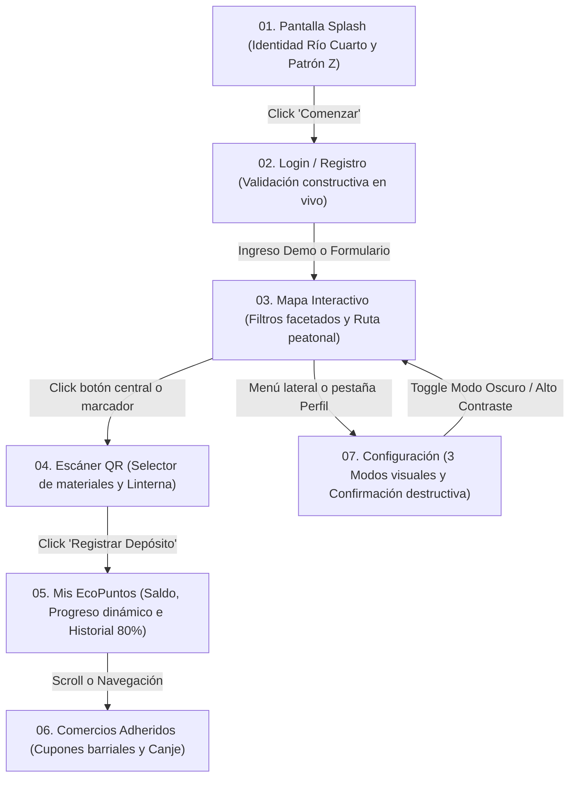

# Guía de Sincronización Figma v2 y Prototipado Interactivo - EcoImperio

## 1. Propósito y Alcance
Esta guía establece la correspondencia bidireccional entre el archivo de diseño en **Figma** (`Reto 4 / Prototipo EFI`) y la implementación de producción de la Web SPA (`index.html`, `style.css`, `app.js`). Permite al equipo y al tribunal docente auditar la fidelidad visual, los componentes interactivos y las transiciones de prototipado.

---

## 2. Estructura de Páginas en Figma

| Página en Figma | Propósito | Equivalente en Código |
| :--- | :--- | :--- |
| **`01. Portada & Design System`** | Tokens globales, escala tipográfica, paleta cromática semántica y matriz de los 5 estados UI. | `style.css` (`:root`, `.btn-primary`, `.touch-target`, `.high-contrast`) |
| **`02. Prototipo Lo-Fi (Wireframes)`** | Estructura en escala de grises, jerarquía y flujos de navegación sin distracciones visuales. | Documentado en `docs/conceptos/08_wireframe.md` |
| **`03. Prototipo Hi-Fi - Light Mode`** | Mockups finales para viewport mobile `390x844px` (iPhone 14) con fondo esmeralda claro y contraste WCAG AA. | `index.html` (estado base sin clase `.dark`) |
| **`04. Prototipo Hi-Fi - Dark Mode`** | Mockups finales en tema oscuro (`#020617` / `#0f172a`) con soporte para ahorro de batería y descanso visual. | `index.html` con clase `html.dark` |
| **`05. Prototipo Alto Contraste (WCAG AAA)`**| Mockups accesibles para baja visión con fondo negro puro (`#000000`), bordes blancos y acento amarillo `#FFFF00` ($\ge 7:1$). | `index.html` con clase `body.high-contrast` |

---

## 3. Matriz de Componentes Maestros y Variantes

### 3.1. Botón de Acción Principal (`CTA Button`)
- **Auto-Layout**: Horizontal, `padding: 14px 24px`, `gap: 8px`, `border-radius: 9999px` (Pill).
- **Variantes interactivas en Figma**:
  - `state=Default`: Fondo `#047857` (Esmeralda oscuro), texto `#FFFFFF` `Inter Bold 16pt`.
  - `state=Hover`: Fondo `#059669` (Elevación visual, sombra `0 4px 6px -1px rgba(0,0,0,0.1)`).
  - `state=Active`: Fondo `#065f46`, escala física `98%` (`active:scale-95`).
  - `state=Focus`: Anillo exterior `#34d399` a `4px` con offset `2px`.
  - `state=Disabled`: Fondo `#9ca3af`, texto `#f3f4f6`, opacidad `55%`, cursor `not-allowed`.
- **Microinteracción en prototipo**: Conexión `While hovering` $\to$ `Change to` `Hover`; `While pressing` $\to$ `Change to` `Active`.

### 3.2. Barra de Navegación Inferior (`Bottom Navigation Bar`)
- **Dimensiones**: `390px x 68px`, Auto-Layout horizontal distribuido equitativamente (`Space Between` / `Space Around`).
- **Anclaje (Constraints)**: `Bottom: Fixed` (`Position: Fixed / Stay in place`).
- **Áreas táctiles**: Cada ícono + etiqueta de texto está contenido en un marco de mínimo `48x48px` (`.touch-target`).
- **Ítems**: `Inicio (Splash/Home)`, `Mapa`, `Escáner QR` (Botón central elevado de `56x56px`), `Puntos`, `Perfil`.

### 3.3. Menú Lateral Desplegable (`Drawer Slide-Over`)
- **Dimensiones**: `320px x 844px`, anclado a la derecha (`Right: Fixed`).
- **Fondo de superposición (Overlay)**: `rgba(15, 23, 42, 0.6)` con desenfoque de fondo (*Backdrop Blur*).
- **Prototipado en Figma**:
  - Disparador: Clic en botón `#btn-open-drawer` (Menú hamburguesa).
  - Acción: `Open Overlay` $\to$ Posición `Top Right` $\to$ Animación `Move In (from Right)` a `250ms Ease Out`.
  - Cierre: Clic fuera o tecla `Esc` $\to$ `Close Overlay`. En código se sincroniza mediante atributo `inert` y foco automático en el botón de cierre.

---

## 4. Guía de Conexión del Prototipo Interactivo (Flujo Completo)

Para la defensa de 20 minutos ante el tribunal docente, el flujo del prototipo debe recorrerse según este orden:

---

## 5. Criterios de Evaluación y Argumento para el Tribunal
1. **Auto-Layout dinámico y Constraints responsivas**: Se demuestra que ningún texto se desborda y las tarjetas de comercios adaptan sus anchos proporcionalmente (50% imagen / 50% contenido).
2. **Cumplimiento WCAG 2.2**: Los 3 temas (Claro, Oscuro y Alto Contraste) cumplen con ratios de contraste $\ge 4.5:1$ y $\ge 7:1$, comprobables mediante el plugin *Stark* en Figma o las DevTools en el navegador.
3. **Cero pantallas sin salida**: Toda pantalla cuenta con retroceso seguro (`← Volver` o barra persistente).
